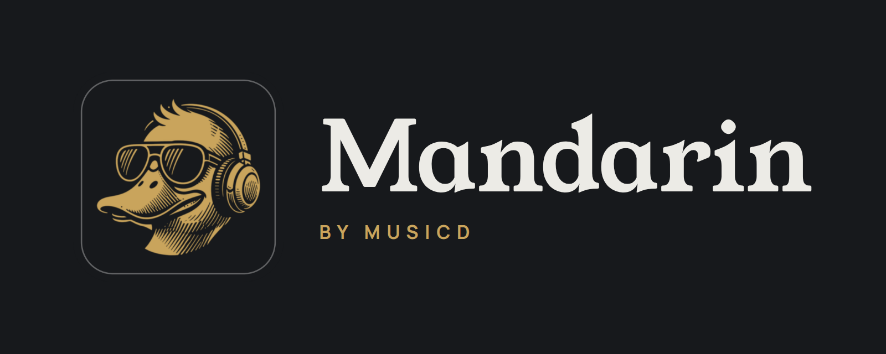

<picture>
  <source media="(prefers-color-scheme: light)" srcset="docs/mandarin-logo-light.png">
  
</picture>

# Mandarin — v1.3.4

**Your own music files, played to Sonos rooms, to UPnP/DLNA renderers (a WiiM, a Chord Poly,
a streamer, an AV receiver), to a USB DAC through Mandarin Bridge and to the Mandarin Android app.**

Mandarin is a music server and its app. The server, on a computer of its own at home, scans your music folders,
names your albums and plays them to the players in your house; you control it from a browser, an iPhone home-screen
app or the Android app, Mandarin Remote. No subscription or streaming account is needed. Album names are looked up
online (MusicBrainz, AcoustID, Wikipedia, Deezer and others); your music files stay on your computer and are never
changed.

Mandarin installs with **[Mandarin OS](#install)**, a system made for it alone: download the image, write it to a USB
stick, start the computer from it and answer the installer's questions. **Mandarin Bridge** turns an Android device,
a Linux computer or a Raspberry Pi with a USB DAC into a room Mandarin plays to.

## 📖 [Everything else is on the site: meltface-80.github.io/Mandarin](https://meltface-80.github.io/Mandarin/)

Every feature and how to use it, the guides to install, set up and troubleshoot, and the downloads, in nine
languages: **[meltface-80.github.io/Mandarin](https://meltface-80.github.io/Mandarin/)**.

**New in v1.3.4** (Mandarin OS 0.1.12; Mandarin Bridge v0.3.21):
* **iBroadcast:** sign in, and your iBroadcast library is in Mandarin's and plays in every room, on every Bridge and
  on the phone.
* **Upload to iBroadcast**, now or on a schedule, from all your music or one drive; it carries on after a restart.
* **iBroadcast albums** can be kept on the phone, edited in Edit album, and identified by the Album Scanner.
* **Export library** as a CSV for Mandarin Migration.
* **Qobuz upsampled to DSD** as your own files are.
* **Mandarin Bridge for Android plays a music player's own DAC**, such as a FiiO R7's, at each track's own rate.

[What's new](https://meltface-80.github.io/Mandarin/whats-new.html) on the site, and every change in the [changelog](CHANGELOG.md).

## Downloads

The newest of each, straight to your device.

| What | Version | Download |
| --- | --- | --- |
| **Mandarin OS**, the system Mandarin installs with (a 64-bit Intel or AMD PC with UEFI) | 0.1.12 | [mandarin-os-0.1.12-x64.img.xz](https://github.com/meltface-80/Mandarin/releases/download/mandarin-os-v0.1.12/mandarin-os-0.1.12-x64.img.xz) for balenaEtcher or dd · [mandarin-os-0.1.12-x64.img](https://github.com/meltface-80/Mandarin/releases/download/mandarin-os-v0.1.12/mandarin-os-0.1.12-x64.img) for a phone; see [Install](#install) below |
| **Mandarin Remote**, the Android app (Android 8.0 or newer) | v1.3.4 | [mandarin-android.apk](https://github.com/meltface-80/Mandarin/raw/main/dist/mandarin-android.apk) |
| **Mandarin Bridge** for Android (a FiiO R7, say) | v0.3.21 | [mandarin-bridge.apk](https://github.com/meltface-80/Mandarin/releases/download/mandarin-bridge-v0.3.21/mandarin-bridge.apk) |
| **Mandarin Bridge** for Raspberry Pi (3, 4, 5, Zero 2 W) | v0.3.21 | [mandarin-bridge-pi-arm64.img.xz](https://github.com/meltface-80/Mandarin/releases/download/mandarin-bridge-v0.3.21/mandarin-bridge-pi-arm64.img.xz) |
| **Mandarin Bridge** for Linux (64-bit Debian, Ubuntu, Raspberry Pi OS) | v0.3.21 | `curl -fsSL https://github.com/meltface-80/Mandarin/releases/download/mandarin-bridge-v0.3.21/install.sh \| sudo sh`, or by hand: [x64](https://github.com/meltface-80/Mandarin/releases/download/mandarin-bridge-v0.3.21/mandarin-bridge-linux-x64.tar.gz) · [arm64](https://github.com/meltface-80/Mandarin/releases/download/mandarin-bridge-v0.3.21/mandarin-bridge-linux-arm64.tar.gz) |
| The server program on its own, what Mandarin on Mandarin OS fetches in Settings → Updates (no need to download it) | v1.3.4 | [linux-x64](https://github.com/meltface-80/Mandarin/releases/latest/download/mandarin-server-linux-x64.gz) · [linux-arm64](https://github.com/meltface-80/Mandarin/releases/latest/download/mandarin-server-linux-arm64.gz) · [sums](https://github.com/meltface-80/Mandarin/releases/latest/download/mandarin-server.sha256) |
| **How Mandarin finds and names your music**, a guide in plain words | | [PDF](docs/Mandarin-music-scanning-guide.pdf) |

On an iPhone or iPad there is nothing to download: open `http://<box address>:3500` in Safari and tap **Share → Add
to Home Screen** ([On your phone](https://meltface-80.github.io/Mandarin/apps.html)).

## Install

Mandarin installs with Mandarin OS, on an always-on computer of its own on the same network as your speakers: a
64-bit Intel or AMD PC with UEFI and wired network, such as a mini PC.

### Mandarin OS

A lightweight system made only to run Mandarin, with its own web page, the system page, to look after everything
([Mandarin OS, step by step](https://meltface-80.github.io/Mandarin/mandarin-os.html)):

1. **Download the image:** `mandarin-os-0.1.12-x64.img.xz` (or the plain `.img` for a phone), from [Downloads](#downloads).
2. **Write it to a USB stick** of 4 GB or more ([how](https://meltface-80.github.io/Mandarin/mandarin-os.html#usb)):
   * **balenaEtcher**: flash `mandarin-os-0.1.12-x64.img.xz` as it is ([how](https://meltface-80.github.io/Mandarin/mandarin-os.html#etcher)).
   * **A Linux terminal:** `xz -dc mandarin-os-0.1.12-x64.img.xz | sudo dd of=/dev/sdX bs=4M conv=fsync status=progress`, with `sdX` the stick ([how](https://meltface-80.github.io/Mandarin/mandarin-os.html#dd)).
   * **An Android phone, with EtchDroid:** write the plain `mandarin-os-0.1.12-x64.img` ([how](https://meltface-80.github.io/Mandarin/mandarin-os.html#android)).
3. **Start the computer from the stick**, with Secure Boot off, and **answer the installer's questions**: its disk,
   the shared folder's user and password, the network, and whether to install Mandarin Bridge for a DAC plugged into
   it ([Install it](https://meltface-80.github.io/Mandarin/mandarin-os.html#install)).
4. **Open Mandarin** at `http://<box address>:3500` (the box's screen shows its address), create your account, and
   copy your music into the shared folder, `smb://<box address>/data`, or plug in a USB drive
   ([Using Mandarin OS](https://meltface-80.github.io/Mandarin/mandarin-os.html#using)).

## Updating

**Settings → Updates → Check for update** in Mandarin updates the server, the Android app and every Mandarin Bridge;
Mandarin OS updates itself in place from its system page, `http://<box address>/`, and by its weekly upkeep
([Updating](https://meltface-80.github.io/Mandarin/install.html#updating)).

## Guides

[Features](https://meltface-80.github.io/Mandarin/features.html) ·
[Mandarin OS](https://meltface-80.github.io/Mandarin/mandarin-os.html) ·
[Mandarin Bridge](https://meltface-80.github.io/Mandarin/bridges.html) ·
[Upsampling and output](https://meltface-80.github.io/Mandarin/upsampling.html) ·
[What each device is sent](https://meltface-80.github.io/Mandarin/formats.html) ·
[SQ-tool](https://meltface-80.github.io/Mandarin/sq-tool.html) ·
[Away from home](https://meltface-80.github.io/Mandarin/away.html) ·
[Qobuz and Tidal](https://meltface-80.github.io/Mandarin/services.html) ·
[Settings for the server](https://meltface-80.github.io/Mandarin/configuration.html) ·
[Your account](https://meltface-80.github.io/Mandarin/account.html) ·
[Logs](https://meltface-80.github.io/Mandarin/logs.html) ·
[Troubleshooting](https://meltface-80.github.io/Mandarin/troubleshooting.html) ·
[How it works, building and testing](https://meltface-80.github.io/Mandarin/how-it-works.html) ·
[CHANGELOG](CHANGELOG.md)

## License

MIT. The Sonos control is ported from Caldera Sonos Bridge and the UPnP to Sonos bridge, by the
same author.
