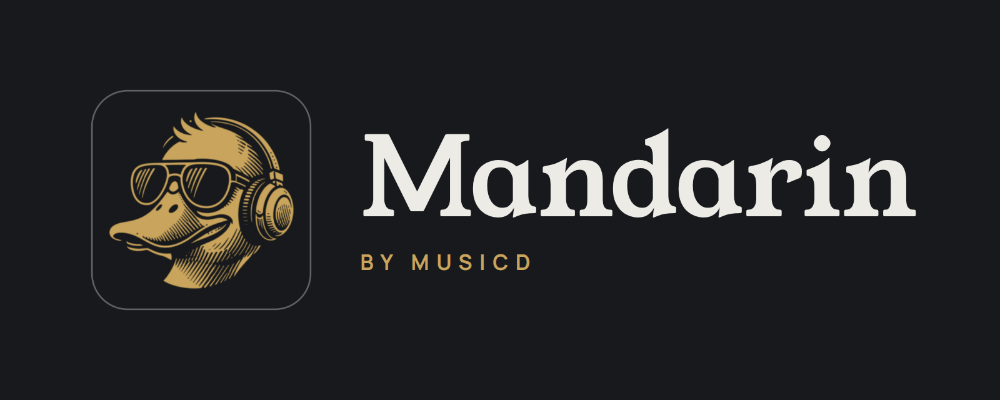

<div align="center">

<picture>
  <source media="(prefers-color-scheme: light)" srcset="docs/mandarin-logo-light.png">
  
</picture>

</div>

# Mandarin — v1.2.2

**Your own music files, played to Sonos rooms, to UPnP/DLNA renderers (a WiiM, a Chord Poly,
a streamer, an AV receiver) and to the Mandarin Android app.**

**📖 Guides, downloads & the install command builder: [meltface-80.github.io/Mandarin](https://meltface-80.github.io/Mandarin/)** · **⬇ [Downloads](#downloads)**

A server on a machine you own scans your music folders and plays them to the players in your
house. You control it from a browser, an iPhone home-screen app or the Android app. No
subscription or streaming account is needed. Album names are looked up online (MusicBrainz,
Wikipedia, Deezer and others); your music files stay on your machine.

```
 browser / iPhone PWA / Android app ──HTTP──▶  Mandarin  ──Sonos UPnP──▶  Sonos rooms
                                                   │      ──UPnP AV / DLNA──▶  WiiM, Chord Poly, receivers, TVs
                                                   │      ──HTTP──▶  the Android app (phone, USB DAC)
                                                   └──── audio: /stream/… ◀────────┘
```

**New in v1.2.2** (since v1.2.1; Mandarin Bridge v0.3.1 still). The [changelog](CHANGELOG.md) has each change.
* **Two acts of one name are two artists** (Airbag from Norway and Airbag from Argentina): told apart by the MusicBrainz
  artist ID in their files, else by Mandarin's own MusicBrainz matches, each with its own page, picture and facts.
* **The signal path in as few steps as it can be,** and Now playing's line under the title the short version of it
  (*Gaussian steep ×16 · 7th-order · DSD256*). See [Signal path](#signal-path).
* **The share card is the card alone:** its review always on it, and bigger; its links, suggestions and settings gone.
* **Logging is on by default,** so a fault seen once is already in the log. See [Logs](#logs).
* **Fixed:** queuing an album stopped the one playing (made as it played, as DSD from PCM); the Android app's Library
  came back filtered to an old search and lost its sort; the Library Scanner stopped again and again ("MusicBrainz
  isn't answering") over albums iTunes had matched; an artist's page showed another act of the same name.

## Downloads

The newest of each, straight to your device. The server's install is a command, below.

| What | Version | Download |
| --- | --- | --- |
| **Mandarin Remote**, the Android app (Android 8.0 or newer) | v1.2.2 | [mandarin-android.apk](https://github.com/meltface-80/Mandarin/raw/main/dist/mandarin-android.apk) |
| **Mandarin server** with Docker (Linux, a Raspberry Pi 4/5, a NAS) | v1.2.2 | `docker pull ghcr.io/meltface-80/musicd-server:latest`, then [Install (Docker)](#install-docker) |
| **Mandarin server** on a Mac (macOS 14 or newer) | v1.2.2 | the one line under [Install on a Mac](#install-on-a-mac) |
| **Mandarin Bridge** for Android (a FiiO R7, say) | v0.3.3 | [mandarin-bridge.apk](https://github.com/meltface-80/Mandarin/releases/download/mandarin-bridge-v0.3.3/mandarin-bridge.apk) |
| **Mandarin Bridge** for Raspberry Pi (3, 4, 5, Zero 2 W) | v0.3.3 | [mandarin-bridge-pi-arm64.img.xz](https://github.com/meltface-80/Mandarin/releases/download/mandarin-bridge-v0.3.3/mandarin-bridge-pi-arm64.img.xz) |
| **Mandarin Bridge** for Linux (64-bit Debian, Ubuntu, Raspberry Pi OS) | v0.3.3 | `curl -fsSL https://github.com/meltface-80/Mandarin/releases/download/mandarin-bridge-v0.3.3/install.sh \| sudo sh`, or by hand: [x64](https://github.com/meltface-80/Mandarin/releases/download/mandarin-bridge-v0.3.3/mandarin-bridge-linux-x64.tar.gz) · [arm64](https://github.com/meltface-80/Mandarin/releases/download/mandarin-bridge-v0.3.3/mandarin-bridge-linux-arm64.tar.gz) |
| The server program on its own, what Settings → Updates fetches | v1.2.2 | [linux-x64](https://github.com/meltface-80/Mandarin/releases/latest/download/mandarin-server-linux-x64.gz) · [linux-arm64](https://github.com/meltface-80/Mandarin/releases/latest/download/mandarin-server-linux-arm64.gz) · [osx-arm64](https://github.com/meltface-80/Mandarin/releases/latest/download/mandarin-server-osx-arm64.gz) · [osx-x64](https://github.com/meltface-80/Mandarin/releases/latest/download/mandarin-server-osx-x64.gz) · [sums](https://github.com/meltface-80/Mandarin/releases/latest/download/mandarin-server.sha256) |
| **How Mandarin finds and names your music**, a guide in plain words | | [PDF](docs/Mandarin-music-scanning-guide.pdf) |

On an iPhone or iPad there is nothing to download: see [iPhone and iPad](#iphone-and-ipad).

---

## Features

<!-- features:start -->

Every feature below has an **ⓘ**: open it for how to switch the feature on and use it.

🏠 **Home**

Rows of albums under a greeting: Not played in 6 months, Listen later, Playlists, Favourites, Recently played, Smart Picks, Label of the week, Random albums, Library and Browse by genre.

<details><summary><b>ⓘ</b> How to set it up and use it</summary>

Open **☰ → Home**. Tap a row's title for all of it. To reorder rows or hide one, open **Settings → Setup → Home Screen**, hold a row's grip and drag it, or switch it off.

</details>

⸻

👆 **Phones and tablets**

On a touchscreen: a bar at the foot on every screen, Now playing too (Menu, Home, Library, Artists, Shelf, Search), and the mini player docked on it on a tablet.

<details><summary><b>ⓘ</b> How to set it up and use it</summary>

Nothing to set up: a phone or tablet gets it in the browser, the iPhone home-screen app and the Android app; a computer with a mouse keeps the top bar. Shelf is in the bar while it is switched on (**Settings → Setup → Shelf**). **☰**, the bar's first button, opens the side menu from any screen. Tap Home or Library again to go back to the top; Search opens its field across the screen. A phone's mini player floats over the bar; a tablet's is docked on it, edge to edge. In the Android app a phone is held upright; a tablet, and a foldable opened, turns and is laid out as a tablet.

</details>

⸻

🎲 **Random Album**

The first tile under the greeting chooses an album you haven't played in 12 months (until Mandarin has 12 months of history, any album) and offers it to play.

<details><summary><b>ⓘ</b> How to set it up and use it</summary>

Choose where to play with the speaker button, then tap **Random Album**. Its disc turns while an album is chosen; then tap **Play now**, **Play next** or **Queue**, or close it.

</details>

⸻

📅 **Album of the day**

One album you haven't played in a year or more (or never), the same on every device, chosen by the server at 00:01 and kept all day.

<details><summary><b>ⓘ</b> How to set it up and use it</summary>

Nothing to set up: it sits beside Random Album on Home, with its own switch in **Settings → Setup → Home Screen**. 00:01 is in the server's time zone (`TZ` in the Docker command).

</details>

⸻

⏳ **Not played in 6 months**

Albums you haven't played in six months. The row stays hidden until Mandarin has six months of your listening.

<details><summary><b>ⓘ</b> How to set it up and use it</summary>

A Home row; tap its title for all of them. Move or hide it in **Settings → Setup → Home Screen**.

</details>

⸻

📚 **Library**

Every album, sorted by name, artist, release date, date added, plays, last played or random, and narrowed by genre, decade, label, format, sample rate, bit depth or first letter.

<details><summary><b>ⓘ</b> How to set it up and use it</summary>

Tap the **Library** row's title on Home, or **Library** in a phone's or tablet's row. **Sort** and **Focus** are in the top bar (at the top right on a phone or tablet); Focus also has *Added in the last* and *Listening* (never played, not in 6 or 12 months). **☰ → Random albums** opens a shuffled wall.

</details>

⸻

🗄️ **Shelf**

A record shop's shelf: your albums' spines in a 3D row, narrowed by genre, artist, year, label, type, format or favourites, put in order, or spun to land anywhere.

<details><summary><b>ⓘ</b> How to set it up and use it</summary>

Its switch is **Settings → Setup → Shelf** (off on a new install); off, it is off entirely and not offered. Open **☰ → Shelf**, **Shelf** in a phone's or tablet's row, `http://<server-ip>:3500/shelf`, or **Shelf ›** on the wall display; the Android app draws it itself. Swipe for one album, swipe and hold to keep turning, flick to spin; tap a spine to bring it to the front, and the one in front to open the album: the library's own album page, in the Shelf's room, with its track times, the heart, **Play now**, **Queue** and **⋯**; hold a track to choose tracks and play or queue those. The choices' eight tabs (Genres, Artists, Years, Labels, Types, Formats, Favourites, Order) narrow the shelf; **#N**, **A → Z** and **Z → A** put the genres in order. **Order** has A → Z by artist, by label and catalogue number, by catalogue number, by year, and random; each device keeps the one chosen. The bar at its foot has what's playing, Spin, the zone and the volume; the queue comes in from the right.

</details>

⸻

🔍 **Search**

Albums, artists and labels as you type, and Qobuz's and Tidal's catalogues beside them: an album from either opens and plays whether or not it is in your library.

<details><summary><b>ⓘ</b> How to set it up and use it</summary>

Tap the magnifying glass in the top bar (in the row at the foot of a phone's or tablet's screen) and type. Labels show when Record labels is on. Signed in to Qobuz or Tidal (Settings → Services), the service's artists and albums follow the library's, from the Library wall's filter too; tap a cover for the album's page, an artist for their page.

</details>

⸻

💿 **Album pages**

Tracks, year and label, write-ups from Wikipedia and Qobuz, and Pitchfork's score where it reviewed the album. Step to the previous or next album of the row you came from.

<details><summary><b>ⓘ</b> How to set it up and use it</summary>

Tap any album. **Play Now** and **Queue** are on the page; **⋯** has Play Next, Shuffle, Radio, Listen later, Edit album and (in the Android app) Download. Swipe sideways, tap **‹ ›** or press ← → for the previous or next album. The track playing has a small disc turning beside its number. A classical album is set out as its works and movements, its composers and performers in its head. On a computer, a TV or a tablet held sideways the page fills the screen in three columns, in the browser and in the Android app on a tablet: the cover, its credits and more by the artist on the left; About this album and about its artist in the middle, with **Read more**; the tracks on the right.

</details>

⸻

🧭 **More by, and similar**

Under an album's review: the artist's other albums, the albums they appear on, and, with a Last.fm key, similar artists and albums. Ones in your library open here.

<details><summary><b>ⓘ</b> How to set it up and use it</summary>

Open any album. For the Last.fm rows, get a free key at last.fm/api/account/create and paste it in **Settings → Setup → API Keys** (or set `LASTFM_KEY`). Read-only: nothing is scrobbled.

</details>

⸻

🎤 **Artists** — *new in v1.2.2*

Every act as a round picture with their name and album count, sorted A to Z, by most albums or at random. Two acts of one name are two artists.

<details><summary><b>ⓘ</b> How to set it up and use it</summary>

On a phone or tablet, tap **Artists** in the row at the foot of the screen. **Sort** is at the top right; **Search** in the row finds an artist by part of the name. Tap one for their page. Two acts of the same name (Airbag from Norway, Airbag from Argentina) are told apart by the MusicBrainz artist ID in their files' tags (as Picard writes it), else by Mandarin's own MusicBrainz matches (**Settings → Library Scanner**), each with its own page, picture and a word to tell them apart.

</details>

⸻

🧑‍🎤 **Artist pages** — *new in v1.2.2*

Who they are, then their discography, the albums they appear on, similar artists and similar albums. Members fold under a heading. One artist however a sleeve credits them.

<details><summary><b>ⓘ</b> How to set it up and use it</summary>

Tap an artist's name on an album's page, on the Artists wall or in Search. Who they are is the act your albums are by: its MusicBrainz ID from your files or matches, else the act MusicBrainz lists for your album titles, never just the first of the name. Facts come from MusicBrainz, Wikidata and Wikipedia, pictures from FanArt.tv (with a key), Wikidata or Deezer, similar artists and albums from Last.fm (with a key) or Deezer. Tap **Members** to unfold a band's line-up. A member's page shows their bands' albums from their years in them; a tap on a member, a band or a similar artist opens theirs. Tap a genre for its albums.

</details>

⸻

👥 **Album credits**

Under an album's tracks: who played, sang, wrote and made it, each with their parts and the tracks they are on, from the files' tags and MusicBrainz.

<details><summary><b>ⓘ</b> How to set it up and use it</summary>

Nothing to set up: the server looks albums up in the background, a second at a time. Eight show at first; **More** for the rest. Tap a name for their artist page.

</details>

⸻

🎸 **Genres on pages**

An album's genres as small chips under its cover, and an artist's, the most used across their albums. A tap opens that genre's albums.

<details><summary><b>ⓘ</b> How to set it up and use it</summary>

Nothing to set up: they come from your files' genre tags. A genre written two ways (*Indie Rock*, *indie rock*) is one, spelled as most of your albums spell it.

</details>

⸻

✏️ **Edit album**

Correct an album's title, artist or year and choose its cover. Edits are kept in the server's database; your music files are not changed.

<details><summary><b>ⓘ</b> How to set it up and use it</summary>

On an album, tap **⋯ → Edit album**.

</details>

⸻

🗂️ **Music folders**

Any number of folders the server can see, added and removed in the app. Changes show by themselves where the file system reports them, otherwise at the next scan.

<details><summary><b>ⓘ</b> How to set it up and use it</summary>

Open **Settings → Music Folders** and add a folder from the list of drives and folders the server can see. A full scan runs every 6 hours (`SCAN_INTERVAL_HOURS`); **☰ → Rescan library** runs one now, then brings Qobuz and Tidal up to date, in that order, where you are signed in with the import on.

</details>

⸻

💽 **One album per folder**

Each folder is one album. Disc folders inside it, such as Disc 1 or CD2, make one album shown disc by disc, with a two-disc symbol on its cover.

<details><summary><b>ⓘ</b> How to set it up and use it</summary>

Nothing to set up.

</details>

⸻

📝 **Untagged files named from folders**

A file with no tags takes its artist, album, year, title and track number from its folder and file names. Nothing is written to your files.

<details><summary><b>ⓘ</b> How to set it up and use it</summary>

Nothing to set up. Those albums are then looked up by the Library Scanner like any other.

</details>

⸻

🏷️ **Every tag kept**

All of each file's tags are read into the server's database, including MusicBrainz IDs, barcode, catalogue number, ISRC and ReplayGain, and used to identify albums.

<details><summary><b>ⓘ</b> How to set it up and use it</summary>

Nothing to set up: tags are read with every scan.

</details>

⸻

🔎 **Library Scanner**

Names albums from their files' identifiers first, then from MusicBrainz by tracks and lengths, with Apple's iTunes catalogue as a second source. Measures ReplayGain for files without it.

<details><summary><b>ⓘ</b> How to set it up and use it</summary>

Open **Settings → Library Scanner**. **Clean up** there removes albums whose files are gone, after showing counts. Matches of 85% or better are applied (with Undo); the rest are left for you to match; a copy that is every track of a bigger pressing is taken as that record. Your files are not changed. **Ask iTunes too** and **Measure ReplayGain** are on the same page; **Scheduling** sets the hours both run, identification first, then ReplayGain album by album.

</details>

⸻

📦 **MusicBrainz pack**

An optional download of every MusicBrainz release with a barcode, about 2 GB on disk. Albums with a barcode are matched from it, also while musicbrainz.org is down.

<details><summary><b>ⓘ</b> How to set it up and use it</summary>

Open **Settings → Library Scanner → MusicBrainz pack** and tap **Download**. **Folder** chooses where it's kept; in Docker that folder needs a writable mount (see Install).

</details>

⸻

▶️ **Now playing**

Cover, track, transport, volume, the queue and history, and a badge saying what the device is being sent. An optional waveform seek bar is drawn from the audio.

<details><summary><b>ⓘ</b> How to set it up and use it</summary>

Tap the bar at the bottom of the screen. The waveform is off until you switch on **Settings → Audio Devices → Waveform**. On a large screen, Now playing can shrink to a card you drag around. On the Queue tab, hold a track to select it and more; **⋯** plays the selection now or next, or removes it; **Clear all** empties the queue.

</details>

⸻

↪️ **Move to another device**

Pick another room, renderer or phone while music plays and it moves there: the queue goes with it, from the same track and second.

<details><summary><b>ⓘ</b> How to set it up and use it</summary>

Tap the speaker button (on the bar or Now playing) and choose the device to move to.

</details>

⸻

📻 **Random Album Radio**

When a device's queue is running out, a random album goes on the end: never one the radio played in the last six months. Switched on per device.

<details><summary><b>ⓘ</b> How to set it up and use it</summary>

Open **Settings → Audio Devices**, tap the device and switch on **Random album radio**. **⋯ → Radio** on an album plays it and switches radio on for that device.

</details>

⸻

🔈 **Sonos**

Play, queue, play next, shuffle, repeat and volume for each Sonos room, and grouping and ungrouping rooms. Sonos plays up to 24-bit / 48 kHz; Mandarin converts anything above.

<details><summary><b>ⓘ</b> How to set it up and use it</summary>

Sonos rooms are found on the network by themselves (`SONOS_HOSTS` if not). Pick one with the speaker button; **Group zones…** in the same list groups them.

</details>

⸻

📡 **UPnP/DLNA renderers**

WiiM, Chord Poly, streamers, AV receivers and TVs on your network, played like a Sonos room, gapless; one with MPD beside it can be handed the whole queue.

<details><summary><b>ⓘ</b> How to set it up and use it</summary>

A renderer found on the network is off until you switch it on in **Settings → Audio Devices**. Then pick it with the speaker button. **Look again** searches the network now. Where MPD is found beside it (a Chord Poly), **Output → Player → Its own player** hands MPD the queue, and **Output → Gapless → Albums as one stream** sends an album as one stream however the device joins files.

</details>

⸻

🎶 **Squeezelite players**

Squeezelite players and Squeezebox-compatible hardware play from Mandarin over SlimProto, one track on into the next from their own buffer, with Output's upsampling and seeking.

<details><summary><b>ⓘ</b> How to set it up and use it</summary>

Start Squeezelite on the network: it finds Mandarin by itself on port 3483, or point it at it (`squeezelite -s <server-ip>`). It shows in **Settings → Audio Devices** under its own name; switch it on. To pause at a change of rate, start it with a rate list and a delay (`-r 44100-768000:500`).

</details>

⸻

🖥️ **Sound devices on the server**

A Mac's own speakers, headphones or USB DAC, played like a Sonos room through Core Audio. On Linux a USB DAC beside the server is Mandarin Bridge's.

<details><summary><b>ⓘ</b> How to set it up and use it</summary>

On a Mac, plug it in and switch it on in **Settings → Audio Devices**: it plays at each track's own rate. On Linux, install [Mandarin Bridge](#mandarin-bridge) for Linux beside the server: it plays the DAC as a room of its own. Details under [Sound devices on the server](#sound-devices-on-the-server).

</details>

⸻

🎚️ **Audio Devices**

Every room, renderer and phone with the rates, depths and formats it takes, your own name for it, and a switch. Renderers play Original or upsampled ×2, ×4 or Max.

<details><summary><b>ⓘ</b> How to set it up and use it</summary>

Open **Settings → Audio Devices** and tap a device. The name you give it is what the speaker list and Now playing show. **Output** is on a renderer's page. **Hide / unhide** takes devices you don't use off the list; tap it again and tick one under Hidden to bring it back.

</details>

⸻

💎 **DSD**

A device that takes DSD is sent the DSF or DFF itself, natively or as DoP; PCM can be made DSD64–256 with a choice of three modulators.

<details><summary><b>ⓘ</b> How to set it up and use it</summary>

On a device's page in **Settings → Audio Devices**, switch the DSD rates it takes on or off; **Output → PCM as DSD** and **Modulator** make PCM DSD. On Linux, a Mandarin Bridge's own page says when the computer's kernel holds back a DAC's native DSD, and the line that frees it.

</details>

⸻

🔊 **Volume Levelling**

ReplayGain per device: Off, Track, Album or Auto, a target from −14 to −25 LUFS, and a level for tracks with no loudness information.

<details><summary><b>ⓘ</b> How to set it up and use it</summary>

Open **Settings → Audio Devices**, tap the device, and set **Volume levelling** (above DSP). Auto plays albums at album level and mixed tracks at track level.

</details>

⸻

🎛️ **DSP**

A parametric EQ of up to ten bands per renderer or phone, headphone profiles from AutoEq, and room correction from an impulse response (a WAV from REW or Dirac).

<details><summary><b>ⓘ</b> How to set it up and use it</summary>

Open **Settings → Audio Devices**, tap a renderer or the phone, and switch on **DSP**. **Room correction** takes one WAV, one for each rate, or a zip of them. Sonos rooms have no DSP here.

</details>

⸻

⚙️ **Playback first**

Playback keeps a processor core of its own, two while DSP is in use. Scanning, ReplayGain and downloads run on the other cores, at the lowest priority.

<details><summary><b>ⓘ</b> How to set it up and use it</summary>

Nothing to set up on Linux. **Settings → Library Scanner → Processor** shows the split. In Docker, `--cap-add SYS_NICE` also raises playback's priority. `PLAYBACK_CORES` sets how many cores playback keeps; 0 shares them all.

</details>

⸻

⭐ **Smart Picks**

Five albums a day from your own library, by artists Deezer lists as related to the ones you've played, topped up from your least-played albums.

<details><summary><b>ⓘ</b> How to set it up and use it</summary>

**☰ → Smart Picks**, or its Home row. **Settings → Setup → Smart Picks** switches it on or off and sets the hour each day's picks are made.

</details>

⸻

📰 **Pitchfork**

Pitchfork's latest album reviews and Best New Music, read in the app, with Play on any album you own.

<details><summary><b>ⓘ</b> How to set it up and use it</summary>

Open **☰ → Pitchfork**.

</details>

⸻

🏢 **Record labels**

Labels from your files' tags or a folder level: a Labels screen, logos from Discogs and FanArt.tv, lookups for albums without a label, and merging of duplicate names.

<details><summary><b>ⓘ</b> How to set it up and use it</summary>

Switch it on in **Settings → Setup → Record labels**. Logos need a Discogs token or FanArt.tv key (**Settings → Setup → API Keys**). On **☰ → Labels**, search and #–Z are in the top bar (on a phone or tablet, #–Z at the top right and Search in the row); hold a tile to select labels to merge.

</details>

⸻

📆 **Label of the week**

With Record labels on, one label from your library on Home all week, with its albums. A new one each Monday.

<details><summary><b>ⓘ</b> How to set it up and use it</summary>

Switch on **Settings → Setup → Record labels**; the row then shows on Home.

</details>

⸻

❤️ **Favourites**

A heart on every album. Hearted albums gather on a Home row.

<details><summary><b>ⓘ</b> How to set it up and use it</summary>

Tap the heart on an album's page. Tap the **Favourites** row's title for all of them.

</details>

⸻

🕒 **Listen later**

Albums put aside to play another time, on a Home row and a screen of their own. Each comes off by itself once every track has been played.

<details><summary><b>ⓘ</b> How to set it up and use it</summary>

On an album, **⋯ → Listen later**, or select several on a wall. Open the list from **☰ → Listen later**.

</details>

⸻

🎵 **Playlists**

Playlists you make, and Dynamic Playlists that follow a saved Library view. A playlist can be shared as text and imported, matched against the other library's tracks.

<details><summary><b>ⓘ</b> How to set it up and use it</summary>

**☰ → Playlists**, **☰ → Dynamic Playlists** and **☰ → Import a playlist**. A playlist's **Share** gives the text to send.

</details>

⸻

🖼️ **Share card** — *new in v1.2.2*

The album as a picture: its cover, release, title and artist, its review with whose words they are, Pitchfork's score where there is one, and the duck in its corner.

<details><summary><b>ⓘ</b> How to set it up and use it</summary>

Tap the share button on an album's page or Now playing; there is nothing to set up. In the Android app, **Copy image** puts the card on the clipboard, to paste into a forum or a message, and **Download** saves it to Pictures/Mandarin; in a browser, **Share…** or **Download**.

</details>

⸻

📺 **Wall display**

A full-screen now playing page for a TV or tablet; on a big TV its reviews and covers are drawn large enough to read from across the room.

<details><summary><b>ⓘ</b> How to set it up and use it</summary>

Open `http://<server-ip>:3500/display` on the screen. Its switch (on by default) and options are in **Settings → Setup → Wall Display**; off, it is off entirely. Tap the screen for its controls; **Shelf ›** opens Shelf.

</details>

⸻

📱 **The Android app**

Mandarin's interface drawn natively by the app, which finds the server home or away and asks again when it's back; lock-screen controls, volume keys, a widget, Android Auto, its updates.

<details><summary><b>ⓘ</b> How to set it up and use it</summary>

Download it from [Downloads](#downloads) and install it (Android 8.0 or newer). Enter the port; it finds the server on your Wi-Fi.

</details>

⸻

🎧 **This phone**

The phone is a player of its own: speaker, headphones or Bluetooth, with queue, history and radio. At home, your other devices can play to it while the app runs.

<details><summary><b>ⓘ</b> How to set it up and use it</summary>

In the Android app, pick **This phone** with the speaker button.

</details>

⸻

🔌 **USB DAC on the phone**

The app's own USB Audio driver plays to a DAC on the phone's port at the file's rate and depth, without Android's mixer; DSD natively or as DoP.

<details><summary><b>ⓘ</b> How to set it up and use it</summary>

Plug the DAC in. It shows on **This phone**'s page in **Settings → Audio Devices**; switch on **USB direct** there.

</details>

⸻

🌉 **Mandarin Bridge**

A USB DAC on an Android device, a Linux computer or a Raspberry Pi, as a room Mandarin plays to: over SlimProto, a continuous stream of PCM.

<details><summary><b>ⓘ</b> How to set it up and use it</summary>

Install it from [Downloads](#downloads): the Android app, the Linux install line, or the Raspberry Pi image to flash. It finds Mandarin by itself; plug the DAC in, then switch the Bridge on in **Settings → Audio Devices**. Details under [Mandarin Bridge](#mandarin-bridge).

</details>

⸻

📈 **Upsampling and output**

For each streamer or DAC: Bit-perfect or upsampled recipes, ×2, ×4 or Max with Standard, Gaussian or long filters in either phase, shaped dither, and PCM made DSD.

<details><summary><b>ⓘ</b> How to set it up and use it</summary>

Open **Settings → Audio Devices**, tap a streamer or DAC, and choose a recipe under **Sound**, or open **Advanced** for each row: Mode, a filter for CD-rate and one for hi-res sources, Phase, Highest rate, Bit depth, the DAC's real bits and Dither, DSD as PCM, PCM as DSD and its Modulator, Gapless. All made as each track plays. Details under [Upsampling and output](#upsampling-and-output).

</details>

⸻

🛤️ **Signal path** — *new in v1.2.2*

Under the album on Now playing, one short line of what goes out (Gaussian steep ×16 · 7th-order · DSD256). A tap shows each step to the DAC.

<details><summary><b>ⓘ</b> How to set it up and use it</summary>

Play to a room and look under the album on **Now playing**; tap it for every step: Source, Bit depth conversion, Volume levelling where it is on, Output, and the device's own word. The ✓ shows only when the device itself says the samples reach the DAC untouched. Details under [Signal path](#signal-path).

</details>

⸻

📊 **SQ-tool**

Proves a zone's DAC gets exactly what is in the file, sample by sample: Mandarin plays a song, records what the DAC is fed, and SQ-tool compares them.

<details><summary><b>ⓘ</b> How to set it up and use it</summary>

Open **Settings → SQ-tool**, choose a song and a zone (a Mandarin Bridge on Android), and press **Record**. Details under [SQ-tool](#sq-tool).

</details>

⸻

⬇️ **Downloads**

Albums kept on the phone as the original files or Opus 256, played without the server. Smart Picks, the Album of the day and new albums can download by themselves.

<details><summary><b>ⓘ</b> How to set it up and use it</summary>

On an album, **⋯ → Download to this phone**. Quality, the download folder, Wi-Fi only and automatic downloads are in **Settings → Setup → Downloads** in the app.

</details>

⸻

📂 **Music on this phone**

A folder of music already on the phone, watched for changes, on Home with Focus and Sort and on artists' pages, played like the library. The server never sees it.

<details><summary><b>ⓘ</b> How to set it up and use it</summary>

In the app, **Settings → Music Folders → On this phone** and choose the folder. Selected with other albums and played on **This phone**, they go into the one queue.

</details>

⸻

✈️ **Offline mode**

One switch: only the music on the phone shows, and the server isn't used. With no connection the app does the same by itself, and reconnects when it can.

<details><summary><b>ⓘ</b> How to set it up and use it</summary>

In the Android app, **☰ → Offline mode**. While offline, a small *Offline* pill sits at the top of the screen: tap it to see why (Offline mode, or the server can't be reached).

</details>

⸻

🌍 **Away from home**

On mobile data the app reaches the server through its own Tailscale, by itself, with no ports opened. Away, only the phone plays: Opus 256 or original files.

<details><summary><b>ⓘ</b> How to set it up and use it</summary>

**Settings → Setup → Away from home** on the server: **Sign in to Tailscale**. Then in the app, the same page: **This phone**. Open the app once at home. Details under [Away from home](#away-from-home-tailscale).

</details>

⸻

🎨 **UI Settings**

Text sizes, grid layout (Auto, 3 or 2 columns, or List) and tile size, saved on each device. On a desktop, text goes up to +100%.

<details><summary><b>ⓘ</b> How to set it up and use it</summary>

Open **Settings → Setup → UI Settings** and pick from each list; it applies at once.

</details>

⸻

👤 **An account, or none**

One username and password kept on the server, or none: a TV showing the shelf or the wall needs nothing typed. The password itself is never sent.

<details><summary><b>ⓘ</b> How to set it up and use it</summary>

On first visit from a device at home, create the account or choose **Use without an account**. **Settings → Account → Ask for a sign-in** switches it on or off: off, the home network and your Tailscale network come straight in, anywhere else still signs in. Details under [Your account](#your-account).

</details>

⸻

⏻ **Restart and shut down**

Restart Mandarin, or shut it down so it stops finding and controlling your speakers until you start it again. In Docker, only Restart.

<details><summary><b>ⓘ</b> How to set it up and use it</summary>

Open the side menu (☰) and tap the **power button** in its top-right corner, then **Restart** or **Shut down**. On a Mac, double-click **Mandarin** on the desktop to start it again. In Docker: `docker stop musicd-server`, then `docker start musicd-server`.

</details>

⸻

💾 **Backup and restore**

Back up settings, players, collection, API keys (with the Tailscale identity) and the whole database, at home or away: to the server, or from the app to a file.

<details><summary><b>ⓘ</b> How to set it up and use it</summary>

Open **Settings → Backup & restore**, tick what to include, then **Back up to the server** (or, in the app, **Back up to a file on this phone**). To restore, pick a backup (or the file), tick the parts and tap **Restore**. Mandarin keeps a backup of how things were first, then restarts.

**What a backup holds.** The API keys part (and the whole database) holds your Discogs, FanArt.tv and Last.fm keys, the Qobuz and Tidal sign-ins (tokens, never a password) and the server's Tailscale identity. Without a passphrase they are in the file as they are, so keep the file as you would keep them. Type a **passphrase** (8 characters or more) before backing up and they are sealed (AES-256-GCM; v0.9.0): restoring them asks for it, and nothing opens them without it. Everything else in a sealed backup restores without it. A backup never holds your password or other devices' sign-ins.

</details>

⸻

🎼 **Qobuz**

Sign in with your Qobuz subscription: your favourites and purchases become albums here, and the Qobuz browser plays anything in the catalogue, streamed through the server.

<details><summary><b>ⓘ</b> How to set it up and use it</summary>

**Settings → Services → Qobuz**: sign in. Then **☰ → Qobuz** to search and play; **+** on a cover adds an album to your Qobuz favourites (a **✓** once added) and so to the library, as does **⋯ → Add to Qobuz favourites** on its page. Details under [Qobuz](#qobuz).

</details>

⸻

🎵 **Tidal**

Sign in with your Tidal subscription on tidal.com: your favourite albums become albums here, and the Tidal browser plays anything in the catalogue, streamed through the server.

<details><summary><b>ⓘ</b> How to set it up and use it</summary>

**Settings → Services → Tidal → Sign in on tidal.com**: open the link, sign in there, come back. Then **☰ → Tidal** to search and play; **+** on a cover adds an album to your Tidal favourites (a **✓** once added) and so to the library, as does **⋯ → Add to Tidal favourites** on its page. Details under [Tidal](#tidal).

</details>

⸻

📝 **Logging** — *new in v1.2.2*

On by default. The Android app, the server and the Mandarin Bridges log what happened, without personal data, for you to send to the developer.

<details><summary><b>ⓘ</b> How to set it up and use it</summary>

In the Android app, **Settings → Setup → Logging**. Use the app as you normally would for 24 hours, then tap **Save log** (it goes to Downloads/Mandarin, the server's and the Mandarin Bridges' logs with it) and send the file. Look through it first. Switching logging off deletes the log, the server's part too, and it stays off. Details under [Logs](#logs).

</details>

⸻

🔄 **Updates**

The server updates itself from GitHub and checks every 12 hours. The Android app and every Mandarin Bridge have their own Check for update beside the server's.

<details><summary><b>ⓘ</b> How to set it up and use it</summary>

**Settings → Updates → Check for update** beside the server, the Android app (in the app) or a Bridge; once it says **Update available**, tap it again. The server starts again in a few seconds, the app's update goes to Android's installer, a Linux or Raspberry Pi Bridge updates itself, and an Android Bridge shows a notification whose tap downloads the update in its browser.

</details>

<!-- features:end -->

## What each device is sent

Each track goes the way the device can take it. The Now playing badge says what was sent.

* **Sonos** plays up to 24-bit / 48 kHz. Within that, the file as stored. Above it, or in a
  format Sonos can't read, FLAC at 24/48.
* **A UPnP/DLNA renderer** has its own ceiling, read from the device. Within it, the file as
  stored; above it, FLAC at the highest rate the device takes in the file's family; upsampled
  ×2, ×4 or to the device's maximum if you choose. DSD goes as the DSF or DFF file itself to a
  device that says it takes DSD files (DSD rates switchable on its page), as PCM otherwise.
* **A Mandarin Bridge** (Android, Linux, a Raspberry Pi): a continuous stream of PCM, over SlimProto; DSD
  as the DSF or DFF itself, natively or as DoP.
* **A Squeezelite player:** each track's file (FLAC, or upsampled; DSD as DSF where it takes it), one on
  into the next from its own buffer.
* **The Android app** on the phone's own output: the file as stored within 24/48, FLAC 24/48
  above it; away from home, Opus 256 by default.
* **A USB DAC on the phone**, with USB direct on: the file at its own rate and depth where the
  DAC takes it, DSD natively or as DoP, FLAC at the DAC's highest rate otherwise.
* **Formats nothing plays as they are** — APE, WavPack, WMA Lossless, 24-bit WAV, more than two
  channels — become FLAC, in stereo.

Conversion is ffmpeg with the SoX resampler and triangular dither. A converted track is written
to a cache as it plays, so the device starts on the first frames, and the next tracks in the
queue are prepared ahead. Replays come from the cache (4 GB by default, least recently played
removed first).

## Install (Docker)

Run it on an always-on Linux machine on the same network as your speakers — a NAS, a
Raspberry Pi 4/5 (64-bit OS), a home server.

If Docker isn't installed yet:

```bash
dietpi-software install 162              # DietPi (162 is its Docker package)
curl -fsSL https://get.docker.com | sh   # Debian, Ubuntu, Raspberry Pi OS
```

Then:

```bash
docker stop musicd-server 2>/dev/null; docker rm musicd-server 2>/dev/null
docker pull ghcr.io/meltface-80/musicd-server:latest

docker run -d \
  --name musicd-server \
  --network host \
  --restart unless-stopped \
  -e TZ=Europe/London \
  -v musicd-server-data:/app/data \
  -v /your/path/to/Music:/music:ro \
  -v /mnt:/mnt:ro,rslave \
  ghcr.io/meltface-80/musicd-server:latest
```

Open **`http://<server-ip>:3500`**. The first scan runs straight away; a big library takes a
few minutes and albums appear as it goes.

> **`--network host` is required.** Sonos players are found by multicast, which does not
> cross Docker's default bridge network — and the speakers fetch audio from this machine's
> own address. Docker Desktop on macOS/Windows has no real host networking, so this needs a
> Linux host. On a Mac, install it without Docker: see [Install on a Mac](#install-on-a-mac).

> **Keep the `musicd-server-data` volume.** It holds the library database, play history,
> playlists, settings and the artwork and transcode caches. Point every future `docker run`
> at the same name.

> **The server doesn't run as root** (since item 354). It runs as user and group 1000 —
> the first user on most Linux machines — and on its first start takes over its data volume
> (from an install that ran as root, that one start can take a minute). It only reads your
> music, so music anyone on the machine can read plays as before. If yours is readable by one
> user only, run the server as that user: `-e PUID=<their uid> -e PGID=<their gid>` (`id`
> on the host gives them). `-e PUID=0` keeps it root, as before.

**The MusicBrainz pack on another drive (optional).** The pack (Settings → Library Scanner) is
2 GB, kept in the data volume unless you choose a folder. To keep it on another drive, add a
writable mount — no `:ro` — to the command above, e.g.:

```bash
  -v /mnt/dietpi_userdata/1tb/mandarin:/packs \
```

then choose `/packs` under **Folder** on that page. The server must be able to write to that folder:
own it by user 1000 (`sudo chown 1000:1000 /mnt/dietpi_userdata/1tb/mandarin`), or set `PUID`/`PGID` to its owner.
Keep the line in every future `docker run`
(an update included): without it `/packs` isn't there, and the page says so. A folder reached
through the read-only `-v /mnt:/mnt:ro,rslave` mount can't be used for the pack.

**A USB DAC on this machine.** The container opens no sound device (since v1.2.1): install Mandarin Bridge for
Linux on the machine itself, beside the container, and the DAC is a room of its own in **Settings → Audio Devices**:

```bash
curl -fsSL https://github.com/meltface-80/Mandarin/releases/download/mandarin-bridge-v0.3.3/install.sh | sudo sh
```

See [Mandarin Bridge](#mandarin-bridge). A container made with `--device /dev/snd` and `--privileged` for sound
doesn't need them any more.

**Music folders, chosen in the app.** Mount your drives or shares into the
container once — e.g. `-v /mnt:/mnt:ro,rslave` — then add any folders inside them in
**Settings → Music Folders**, as many as you like, and remove them there too. The folder
picker lists every drive and share the server can see.

> **DietPi (and any network share mounted on demand):** DietPi-Drive_Manager mounts USB
> drives and network shares under `/mnt`, and mounts shares only when they're first opened.
> A container started with a plain `-v /mnt:/mnt:ro` never sees those later mounts — the
> folder looks empty. End the line with **`,rslave`** (`-v /mnt:/mnt:ro,rslave`) so mounts the
> machine makes afterwards reach the server too, then re-create the container. Music Folders
> says so when it spots a share it can't see. `/music` is
the first folder until you change the list. A folder that goes missing for a while (a drive
asleep, a share that dropped, part of it unreadable, most of it gone at once) keeps its
albums; the page says so and offers to forget it.

A `docker-compose.yml` is in the repository: set your music path and `docker compose up -d`.

### Build it yourself instead

```bash
git clone https://github.com/meltface-80/Mandarin.git
cd Mandarin
docker build -t musicd-server:local .
# then the docker run above, with musicd-server:local as the image
```

### Updating

**In the app:** Settings → **Updates** → **Check for update** beside the server → **Update available**. The
server downloads the new release from GitHub, swaps it in and restarts itself in a few seconds;
a browser's page reloads on its own. In the Android app the app has its own **Check for update**
beside it, and what each update brings is listed under them. It also checks twice a day and shows a banner when a new
version is out. (From v0.1.3 on — an older container needs one update the manual way.)

Since v0.9.0 Mandarin's server is one program, in C#, with no Node.js anywhere. An update from
the app fetches that program of the new version for your machine (x64 or ARM64) from the
release, checks it against the release's sums, puts it and the new page in place, and starts
again in the same container — a few seconds. If it can't start again in place, it stops and
Docker's restart policy (`--restart unless-stopped`, as above, or `restart: unless-stopped` in
`docker-compose.yml`) starts the container again; without one, start it yourself (`docker start
musicd-server`).

The new program is checked and laid in beside the old before anything is swapped (v1.1.9): if
something fails after the swap, the old one (kept as `mandarin-server.prev`) is put back, and a
folder the release can't be written over is named before anything is changed.

**The Mandarin Bridges** (item 291): every Bridge Mandarin knows, on Android, Linux or a Raspberry
Pi, has a row of its own on Settings → **Updates**, its name and version, and its own **Check for
update**, as the server's and the app's rows: it asks GitHub now and becomes **Update available**
when a newer build is published for it (the rows also find one by themselves within a minute or
so). A tap on **Update available** asks the Bridge to update itself: it fetches the
release from GitHub, checks it against the checksum published with it, and puts it in place.
* **Linux and the Raspberry Pi:** in a few seconds, by itself. The new build goes in the Bridge's
  data folder and the program installed hands over to it as it starts again; one that fails as it
  starts is let go, and the installed one runs on.
* **Android:** **Update** puts a notification on the device; its tap downloads the update in the browser,
  and Android's installer asks you to install it. The Bridge holds no permission to install apps itself
  (Google Play Protect called that harmful, v0.2.2).
* An Android Bridge from before v0.2.1, or a Linux or Raspberry Pi Bridge from before v0.3.1, needs one last update by hand, from [Downloads](#downloads)
  (a Linux or Pi Bridge before v0.3.1 asked GitHub in a way it refuses, and its update failed).
* A test build of Mandarin's follows the Bridges' test builds (the **test-bridge** pre-release),
  and a numbered one follows their numbered releases (Mandarin Bridge v0.3.1 with Mandarin v1.2.2).

**Manually** — also the way to pick up changes to the image itself (ffmpeg, the audio engine gone from it in
v1.2.1, and the move to v0.9.0 from an image with Node.js in it):

```bash
docker pull ghcr.io/meltface-80/musicd-server:latest
docker stop musicd-server && docker rm musicd-server
# re-run the docker run command above — the data volume carries everything over
```

## Install on a Mac

Mandarin runs on a Mac without Docker: macOS 14 or newer, Apple silicon or Intel. The Mac needs to
stay on, on the same network as your speakers.

**1. Open Terminal**: press Command-Space, type **Terminal** and press Return.

**2. Paste this line** and press Return:

```bash
/bin/bash -c "$(curl -fsSL https://raw.githubusercontent.com/meltface-80/Mandarin/main/tools/mac/install.sh)"
```

**3. Answer what it asks:**
* **Your Mac's password**, if it asks (for Homebrew, the Mac's package installer): type it and press
  Return. Nothing shows as you type; that's normal.
* **Your music folder**: a Finder window opens. Click the folder your music is in (on the Mac or on
  an external drive) and click **Choose**.
* **The MusicBrainz pack**: where to keep it, if you download it later (optional, about 2 GB).
  **On this Mac** is fine; **Choose a folder...** to put it on another drive.
* **Keep this Mac awake**: choose **Keep awake** so the music doesn't stop when the Mac would sleep.
* **Allow** if macOS asks to let **mandarin-server** find devices on your network or open your
  files. Mandarin needs both to reach your speakers and read your music.

**4. Done.** Mandarin opens in your browser: create your account, or choose **Use without an account**. It starts by itself every time you
log in. On a phone, open the address Terminal shows at the end (`http://<mac-ip>:3500`).

**On a Mac, as on Linux:**
* **Updates** come from the app (Settings → **Updates**): the new version's server for your Mac,
  checked against the release's sums, then started in place.
* **A USB DAC** plugged into the Mac: in **Settings → Audio Devices**, switch it on. Mandarin plays it
  through Core Audio at each track's own rate, holding it while it plays so nothing else is mixed in.
* **Away from home**: **Settings → Away from home** turns on Mandarin's built-in Tailscale, as on Linux.
* **Shut down and start again:** the **power button** at the top right of the side menu (☰) →
  **Shut down** stops Mandarin; double-click **Mandarin** on the desktop (or in your Applications
  folder) to start it again. It also starts when you log in.
* **Your data** (library, history, playlists, settings) is kept in `~/Mandarin/data`.
* **No albums?** macOS may be keeping Mandarin out of the folder. In System Settings → Privacy &
  Security → **Full Disk Access**, click **+**, press Command-Shift-G, paste
  `~/Mandarin/server/bin/mandarin-server`, and click **Open**.
* **Stop Mandarin starting at login:** `launchctl unload ~/Library/LaunchAgents/app.mandarin.server.plist`

## Configuration

Everything is optional; pass any of it with `-e NAME=value`.

| Variable | Default | Purpose |
| --- | --- | --- |
| `PORT` | `3500` | The web interface, the API, and where speakers fetch audio. |
| `TZ` | UTC | Your time zone — Album of the day changes over at 00:01 and Smart Picks at local midnight. |
| `SONOS_HOSTS` | — | A speaker's IP (comma-separated for several), for when multicast discovery is unreliable. One is enough. |
| `ART_HOSTS` | — | Hosts on your own network a picture may be fetched from (comma-separated names or IPs): a radio station's logo served at home, say. Mandarin never fetches a picture from its own machine or your network otherwise; the Sonos speakers' own addresses are always allowed. |
| `UPNP_HOSTS` | — | UPnP/DLNA renderers to ask by address (an IP, or a description URL like `http://192.168.1.50:49152/description.xml`), for when multicast discovery misses them. |
| `SERVER_IP` | auto | The address speakers fetch audio from. Auto picks the machine's LAN address, skipping VPN, Docker and VM interfaces, and searches for speakers on every LAN interface. Set it to pin one. |
| `INCLUDE_ZONES` | — | Offer only these rooms, e.g. `Kitchen,Study`. |
| `EXCLUDE_ZONES` | — | Offer every room except these. |
| `SCAN_INTERVAL_HOURS` | `6` | How often the music folders are re-checked in full (only changed files are re-read). Between those, an album copied in or deleted is noticed as it happens: through the file system's own notifications, and on a network share or FUSE folder (SMB, NFS, mergerfs), whose changes made elsewhere aren't told, by looking at its folders every 30 seconds. A deletion shows a few seconds after it; a long copy is read at least every 30 seconds while it goes on, so albums appear one by one. Rescan any time from the menu. |
| `TRANSCODE_CACHE_GB` | `4` | Disk kept for converted tracks. An upsampled track is several times a CD-rate one: with upsampling on, 16 is a better number. |
| `TRANSCODE_CONCURRENCY` | `2` | How many tracks are converted at once. |
| `PLAYBACK_CORES` | auto | Processor cores kept for playback alone: one, or two while DSP is in use. `1` or `2` fixes the number; `0` shares every core. *Settings → Library Scanner → Processor* shows the split. |
| `MUSIC_DIR` | `/music` | Where the library is mounted inside the container. |
| `TRUSTED_PROXIES` | — | Reverse proxies whose word on who asked is believed (addresses or ranges, comma-separated): `127.0.0.1` for an nginx, Caddy or `tailscale serve` on the same machine. The built-in Tailscale needs nothing here. |
| `PUID` / `PGID` | `1000` | The user and group the server runs as inside the container: give your music's owner if it is readable by that user only. `PUID=0` runs it as root. |
| `TS_AUTHKEY` | — | Sign the server's built-in Tailscale in with an auth key instead of from *Settings → Setup → Away from home*. |
| `TS_HOSTNAME` | `musicd` | The server's name on your tailnet. |
| `TAILSCALE` | on | `off` leaves the built-in Tailscale out (Tailscale on the host still works). |
| `LOCAL_AUDIO` | on | `0`: leave a Mac's own sound devices out of *Settings → Audio Devices* (a Linux server lists none). See [Sound devices on the server](#sound-devices-on-the-server). |
| `SQTOOL_PYTHON` | `python3` | The Python 3 (with numpy) that runs [SQ-tool](#sq-tool). |
| `TAILSCALE_ADDRESS` | auto | The server's address away from home, if the one found on the host's `tailscale0` isn't the one to use — an IP, a MagicDNS name, or a full `https://` address. See [Away from home](#away-from-home-tailscale). |
| `MUSICBRAINZ_URL` | musicbrainz.org | Another MusicBrainz web service (a mirror) for the identification scan, release days and an album write-up's year. |
| `IDENTIFY` | on | `0` leaves the identification scan out entirely. |
| `MBPACK_DIR` | data folder | Where the MusicBrainz pack is kept (Settings → Library Scanner); overrides the folder chosen there. |
| `ITUNES_COUNTRY` | US | The Apple store the identification scan's iTunes lookups use (`GB`, `DE`…). |
| `AUTOEQ_URL` | GitHub | Where AutoEq's results are read from for headphone profiles (Settings → Audio Devices → a device → DSP). |
| `LASTFM_KEY` | — | A Last.fm API key for similar artists and albums on album and artist pages, until one is saved in *Settings → Setup → API Keys* (which then wins). |
| `DEBUG` | — | Log every API call. |

Settings for the FanArt.tv key (artist photos, on artist pages and the wall display), waveform, Smart Picks,
the wall display and the Home rows are in the app's Settings and are saved in the data volume.

## Your account

Mandarin has **one account**, kept on the server itself — nothing online — or, if you'd rather, none
(v1.1.8). On a new install the server does nothing until you choose:

1. Open `http://<server-ip>:3500` on a device **on your home network** (a browser, the iPhone
   home-screen app, or the Android app) and choose a username and password, **or** tap
   **Use without an account**.
2. With an account, every other device signs in with it once and is remembered.
3. **Settings → Account** lists every device, with a *Sign out* button for each, and changes the
   password.

**Ask for a sign-in** (*Settings → Account*, on the page and in the Android app) switches the
sign-in on or off. An install that had an account before v1.1.8 keeps asking until you switch it
off. Off, anything on your home network or on your own Tailscale network (100.64.0.0/10) comes
straight in: a TV showing the shelf or the wall needs nothing typed. Each browser and app is still
a device of its own, listed in *Settings → Account*. From anywhere else (a port forwarded to the
internet) a sign-in is still needed, and with no account there is none to give. Switching it on
with no account asks you to create the account first; devices already in stay in until you sign
them out.

With the sign-in off, a device comes in without one only when it asks for the server by a name used
at home — its address, a bare name, or one ending .local, .lan, .home.arpa or .ts.net — so another
web site can't reach it through a name of its own (v1.1.9). Anything but a read must come from
Mandarin's own page or the Android app: a page of another site open in a browser at home can't
restart the server, change a setting or restore a backup. A device let in without a password works
only from home and your tailnet, never from the internet. Behind a reverse proxy (an nginx, Caddy or
`tailscale serve` on the same machine, or one elsewhere on your network), name it in `TRUSTED_PROXIES`
(`-e TRUSTED_PROXIES=127.0.0.1` for one on the same machine) and have it say who asked
(`X-Forwarded-For`, `X-Real-IP` or `Forwarded`). Mandarin believes only the proxies named and its own
built-in Tailscale: a request that names a caller through anything else, or a named proxy that names
nobody, is taken as the internet, never home, and the log says so.

The password never crosses the network, even on plain http: devices prove they know it with
SRP (the scheme Apple uses for HomeKit pairing), and the server proves it knows the account
back. The server stores only an SRP verifier, never the password.

Five wrong passwords from one address in 15 minutes lock it out for 15 minutes (for IPv6, its whole
/64), and guesses sent all at once count as they arrive, so no more than five are ever tried.

**Forgot the password?** On the server run

```bash
docker exec musicd-server /app/server/bin/mandarin-server reset-password
```

It removes the account and signs every device out; your library, edits, playlists and history
stay. Then create the account again from a device at home.

Sonos speakers can't sign in: the addresses they're given carry a signature, and the speakers'
own addresses are let through, so playback is unaffected.

## iPhone and iPad

Open `http://<server-ip>:3500` in Safari, tap **Share → Add to Home Screen**. It opens full
screen like an app, with the same interface as the Android app.

## Android

The app is in **[android/](android/)**, a native app (Kotlin and Jetpack Compose). Enter the port (3500 unless you changed it) and it finds
the server on your Wi-Fi, or type the address; then sign in, or create the account on a new
server (or use it without one), in the app. With the sign-in switched off, it goes straight in. Its features are listed under [Features](#features).

**Download it from [Downloads](#downloads)** (*mandarin-android.apk*, Mandarin Remote)
— the newest build, published by GitHub Actions on every version merged to `main`. Sideload it
on Android 8.0 or newer. The build itself is named `Mandarin-Android-<version>.apk` (since
v0.9.7); this link keeps one name so it always points at the newest.

**Updates install over the top.** From v0.6.10 the published app is a release build signed with
the project's own private key, and every update after it installs in place.

**Coming from a build before v0.6.10?** Those were signed with a different, shared key, so
Android refuses the update ("conflicts with an existing package"). Uninstall the app once,
install the app from [Downloads](#downloads),
open it, enter the server's address and sign in again. Albums downloaded to the phone go with
the uninstall, so download them again. After that, never again.

**Building the app yourself?** Without the `MUSICD_KEYSTORE_BASE64` and
`MUSICD_KEYSTORE_PASSWORD` secrets, a build is signed with the shared key committed here
(`android/app/musicd-debug.keystore`) and named `…-shared-key.apk`. It can't update the
published app, nor the published app it.


## Mandarin Bridge

Mandarin Bridge (once Mandarin USB) is Mandarin's own player for a USB DAC: a device with the DAC on its USB port
becomes a room Mandarin plays to, bit-perfect. It finds Mandarin on the network by itself (SlimProto, port 3483; a
Linux one can be pointed at it with `--server`), and Mandarin reads the DAC whole from it (every rate, depth and DSD
multiple, nothing to tick); Now playing's [signal path](#signal-path) says what it feeds the DAC, in its own words.
Download each from [Downloads](#downloads) (v0.3.3); after that it updates from **Settings → Updates**
([Updating](#updating)), and its log is in the app's Save log ([Logs](#logs)).

**Updated: over SlimProto, Mandarin now sends Mandarin Bridge a continuous stream of PCM (DSD still goes as DSD).**

* **Android** (a FiiO R7, say): Mandarin's own USB driver claims the DAC from Android and feeds it at each track's own
  rate and depth, DSD natively or as DoP, and keeps the device awake. Install the APK, open it once, plug in the DAC
  (tick *always*), then switch it on in **Settings → Audio Devices**. Setting it up, building it and how it fits
  together: [bridge/README.md](bridge/README.md).
* **Linux** (a computer beside the DAC, the one Mandarin runs on included): `curl -fsSL https://github.com/meltface-80/Mandarin/releases/download/mandarin-bridge-v0.3.3/install.sh | sudo sh`,
  then switch it on in Mandarin; its own page is at `http://<it>:49494/`. Native DSD on Linux is the kernel's to
  offer: where the DAC says it takes DSD natively and the kernel offers it only DoP, the Bridge's page and log give the
  one line that frees it (an `snd-usb-audio` option in `/etc/modprobe.d`, then replug). See
  [bridge/linux/README.md](bridge/linux/README.md).
* **Raspberry Pi** (3, 4, 5 or Zero 2 W): flash `mandarin-bridge-pi-arm64.img.xz` with Raspberry Pi Imager, plug in
  the DAC and power on; its page is at `http://mandarin-bridge.local:49494/`, or with no network yet it opens its own
  *Mandarin Bridge Setup* Wi-Fi. See [bridge/pi/README.md](bridge/pi/README.md).

A Bridge that was a UPnP renderer (before v0.3.0) keeps the name and settings Mandarin had for it, and one whose app
is installed again is the device it was. Its test builds are on the
[test-bridge](https://github.com/meltface-80/Mandarin/releases/tag/test-bridge) pre-release.

## Upsampling and output

Each streamer, DAC, Mandarin Bridge or Squeezelite player has its own **Output** (*Settings → Audio Devices → a
device → Output*). It opens with **Sound**, its settings as recipes: **Bit-perfect**; where the device takes more than
48 kHz, **Upsampled** with the Standard filter, with the Gaussian ones, with them in minimum phase, and with the Very
long filter and shaped dither; where it takes DSD, **DSD** at its highest multiple with the 7th-order modulator. Each
says what it does for that device; a tap sets what it names. **Custom**, or any row changed, opens **Advanced**:

* **Mode:** Original (each track at its own rate), or upsampled ×2, ×4 or Max (the highest rate the device takes in
  the track's family), made on the server in 64-bit float as the track plays.
* **Filters:** one for CD-rate sources and one for hi-res sources (or the same): **Standard** (SoX's for PCM,
  Mandarin's own on the way to DSD), **Gentle**, **Gaussian** (smooth, very short ringing, the top of a CD a little
  down), **Gaussian steep** (flat almost to 22 kHz, every sample of the file kept), **Gaussian hi-res** (for 88.2 kHz
  and up), and **Long** and **Very long** (the standard filter made 8 and 32 times as long: flat to 21.8 and 21.9 kHz
  for a CD and 270 and 284 dB down from 22.1 kHz; a track takes 0.15 and 0.6 s longer to start, and Very long takes
  some 400 MB while it plays).
* **Phase:** Linear or Minimum, for both filters: in minimum phase a filter keeps its levels at every frequency and
  puts its ringing after a sound (Gaussian steep keeps every sample of the file only in linear phase).
* **Highest rate:** Auto (as high as the device takes), 96k, 192k or 384k: nothing goes above it, upsampled or not.
  ×16 (705.6 and 768 kHz) goes as WAV where the device takes WAV.
* **Bit depth:** Auto (24), 24 or 32, for a track converted or upsampled; 32-bit FLAC only where a device is set to 32.
* **Real bits** and **Dither**, where Mandarin makes the PCM: the bits the DAC resolves above its own noise (as sent,
  or 23 to 20) and Flat (the default) or Shaped dither of the 3rd or 5th order, its noise moved above the audio band
  (made at 88.2 kHz and up).
* **DSD as PCM:** for DSD sent to the device as PCM, the DSD modulator's ultrasonic noise taken off above 50 or 30 kHz.
* **PCM as DSD** and its **Modulator:** for a device that takes DSD, the library's PCM made DSD64, DSD128 or DSD256 as
  it plays and sent as DSF, gapless; the 7th order, the 7th order wide (its noise held down to 50 kHz, DSD128 and
  DSD256) or the 9th order (quieter in the audio band, DSD64 and DSD128). A 48 kHz-family track stays in its own
  family. Output says how fast this server makes it.
* **Player:** where a renderer has MPD beside it, as a Chord Poly does, UPnP or **its own player**, handed the queue
  to play one track into the next by itself.
* **Gapless:** **Albums as one stream** sends an album's tracks as one stream, start to end, gapless however the
  device joins files. A Mandarin Bridge is played one continuous stream anyway, and a Squeezelite player joins tracks
  from its own buffer, so neither has the switch.
* **Fixed volume** and **Volume levelling**, then **DSP** (EQ, headphone profiles, room correction from an impulse
  response), in this order: levelling, headroom, the DSP at the track's own rate, then upsampling.

Upsampling and making DSD take far less of the processor than they did, with the same output: PCM as DSD256 takes
37% of one core per second of music where it took 68% (measured on a 2.1 GHz Xeon). A track upsampled or made DSD as
it plays gets the processor: playback keeps all the cores but one while it is made, or as many as *Settings → Library
Scanner → Processor → Cores for upsampling and DSD* says. The phone has the same Output when it plays through a USB
DAC. For a bit-perfect result, Output is **Bit-perfect** (Mode Original) and the volume fixed.

## Signal path

Under the album on Now playing, one short line of what goes out (*Gaussian steep ×16 · 7th-order · DSD256*,
*Long ×2 · 24/88.2 kHz*); a tap shows every step from the file to the room, in as few as it can be — **Source**
(*FLAC 16-bit 44.1 kHz 2ch*), **Bit depth conversion** where Mandarin works the samples (*16-bit to 64-bit float*),
**Volume levelling** where it is on (*−7.3 dB · ReplayGain*), **Output** (the filter, the modulator and what goes out,
in one line, with the dither where Mandarin makes it) and **The DAC is fed** (what the device itself reports feeding
its DAC). A 16-bit track to a 32-bit DAC reads, as the Bridge on a FiiO R7 says it,
*"PCM 44.1 kHz, the 16-bit samples padded to 32 bits for the DAC, fixed volume: the samples untouched — as Mandarin
Bridge reports it"*; where the device doesn't say the samples go untouched, *"sent as 32-bit"*. The ✓ is there only
when the device says the samples reach the DAC untouched in the format sent: Mandarin Bridge and Mandarin's audio
engine say it; a WiiM's own API says only the format, so it has none. Whether every sample reaches the DAC is for
[SQ-tool](#sq-tool) to prove.

## Qobuz

Mandarin streams from Qobuz with a Qobuz subscription (v0.6.23), the way the Lyrion Music
Server's Qobuz plugin does — the same API, the same credentials, the same rules. Experimental,
in line with Qobuz's terms of service; those who use it do so at their own risk.

* **A subscriber signs in** (*Settings → Services → Qobuz*). Mandarin keeps the sign-in token, never
  the password. Qobuz decides what the account may stream.
* **Your favourites and purchases are albums here** — every one, brought up to date shortly after
  signing in, every six hours, and when you add a favourite: on the walls, in search, Smart Picks,
  Listen later and playlists, with a Qobuz mark on the cover. *Favourites and purchases in the
  library* on the Services page switches this off.
* **Favourites follow both ways, by themselves** (v0.7.3). Remove an album from your Qobuz
  favourites here and it is gone from Qobuz and off the walls within the moment; add one and it
  is on them. A favourite added or removed in the Qobuz app follows here on the next look: the
  server checks every two minutes, and the page checks when you come back to Home or the Library
  wall. An album's page says why it is in the library — a favourite or a purchase since a date, a
  playlist's, or only played — and its release date when it is not out yet.
* **The Qobuz browser** (*☰ → Qobuz*): search, new releases, best sellers, most streamed, press
  awards, editor's picks, an artist's albums, as the album grid the rest of Mandarin draws, each
  cover with its **+** for your Qobuz favourites. Tapping an album opens its page here, the same
  page as any album: Play now, Play next, Queue, or from a track, to the zone chosen. An album
  played without being kept is known here for a month (its page, Now playing, history) and stays
  off the walls.
* **Your Qobuz playlists and favourite tracks are playlists here**: each playlist by its Qobuz name,
  and *Qobuz favourite tracks*, on the Playlists screen, brought up to date with the library. The
  albums their tracks come from are known (the tracks play, Now playing has the cover) but stay
  off the walls unless they're favourites.
* **Signed out, it all steps aside**: Qobuz albums and playlists leave the walls and the Playlists
  screen while their rows stay, so signing in puts everything straight back. **Clean up** on the
  Library Scanner page removes what's no longer wanted — Qobuz albums not in your favourites,
  purchases or playlists (all of them while signed out), and, separately, albums whose files are
  gone from the server — after showing you the counts; plays stay in history.
* **Two favourites, kept apart.** The **+** on a Qobuz album's cover in the browser (a **✓** once
  added), and **Add to Qobuz favourites** / **Remove from Qobuz favourites** in the ⋯ menu on the
  album's page here, are your *Qobuz* favourite, and that is what puts the album in the library.
  The **heart** is Mandarin's own favourite, as on any album.
* **Every track is streamed through the server**: when a player comes to fetch it, Mandarin asks
  Qobuz for that one track (a signed request, as Qobuz requires) and feeds the player from its
  transcode cache — a Sonos room gets 24/48 at most, a streamer or a USB DAC what it takes, the
  phone what its DAC takes, with DSP and Volume Levelling as for a file. The next track is made
  ready behind the one playing, so albums play gaplessly. *Stream quality* on the Services page
  sets the most asked for (CD, Hi-Res 24/96, Hi-Res 24/192); the subscription sets the ceiling.
* **Every play is reported to Qobuz** (its streaming start and end), as Qobuz's own apps report
  them, so artists are paid. **Nothing is downloaded**: a Qobuz album has no *Download to this
  phone*, no *Edit album*, no waveform, and is not in offline mode; the cache holds only what the
  queue needs, pruned as the cache fills, and plays nothing once the account is signed out.

The app id and secret are the ones the Lyrion plugin carries, as Qobuz answers no application
requests; Qobuz leaves that plugin be because of how it behaves, and Mandarin behaves the same.

## Tidal

Mandarin streams from Tidal with a Tidal subscription (v0.6.24), the way the Lyrion Music
Server's Tidal plugin does — the same API, the same credentials, the same rules — and Tidal
albums live in Mandarin exactly as Qobuz albums do (above): the walls, the browser, playlists,
Clean up, the two favourites, the server's transcode cache, nothing downloaded. Experimental, in
line with Tidal's terms of service; those who use it do so at their own risk.

* **A subscriber signs in on tidal.com** (*Settings → Services → Tidal → Sign in on tidal.com*):
  Mandarin shows a link and a code, you sign in there on any device, and Mandarin notices by
  itself. It keeps the sign-in token, renewed as Tidal requires, never a password.
* **Your favourite albums are albums here**, every one, with a Tidal mark on the cover;
  *Favourites in the library* on the Services page switches this off. **Your Tidal playlists and
  favourite tracks are playlists here**, as with Qobuz. **Favourites follow both ways, by
  themselves** (v0.7.3), as with Qobuz: removed here, gone from Tidal and the walls at once;
  changed in the Tidal app, here on the next look (two minutes, or when you come back to Home).
* **The Tidal browser** (*☰ → Tidal*): search, new releases, recommended, top, rising, an
  artist's albums, as the album grid, each cover with its **+** for your Tidal favourites; an
  album opens on its page here. The ⋯ menu on a Tidal album's page has **Add to Tidal
  favourites** / **Remove from Tidal favourites**.
* **The stream.** *Stream quality* on the Services page is CD (FLAC 16/44.1) or Hi-Res: Tidal's
  hi-res FLAC, up to 24/192, where an album has it and the subscription allows. Tidal sends
  hi-res as MPEG-DASH (an initialisation piece and numbered segments), which the server joins
  into one stream for ffmpeg on its own loopback; where Tidal answers a hi-res ask with anything
  else, CD quality is asked for instead. What Tidal actually streams a track at is learnt the
  first time it is played and the album's badge corrected. Tidal has no play reports.

The client id and secret are the ones the Lyrion plugin carries, as Tidal's developer programme
answers no streaming requests; Tidal leaves that plugin be because of how it behaves, and
Mandarin behaves the same.

## Sound devices on the server

**On Linux, Docker included, Mandarin plays no sound device of its own (v1.2.1).** A USB DAC on the computer Mandarin
runs on is played by [Mandarin Bridge](#mandarin-bridge) for Linux, installed beside it with one line, and the DAC is
a room of its own in *Settings → Audio Devices*. The server used to open the computer's sound cards itself (ALSA), kept losing the DAC
and competed with the Bridge for it. A card it had in Audio Devices is forgotten by itself, the container needs no
`--device /dev/snd` or `--privileged` for sound, and the image no longer carries the audio engine.

**On a Mac**, the Mac's own outputs (its speakers, headphones, a USB DAC) can be played to like a Sonos room:

1. Plug the DAC in. Within 30 seconds (or after **Look again**) it is listed in *Settings → Audio Devices*, off.
   Switch it on; it is then in the speaker list.
2. On its page: the rates it takes, **Output**, **Fixed volume**, **Volume levelling** and **DSP**, as for a renderer.

How it plays: **Mandarin's audio engine** (`engine/`, a native program written in C#, downloaded once) holds the
device open through Core Audio, at each track's own rate. ffmpeg decodes each track straight into the engine's own
buffer, a few minutes ahead. The next track at the same rate goes into the open device with nothing between them; a
track at another rate reopens it, after half a second of silence at the new rate so the DAC settles. Mandarin's slider
scales the samples on a curve of 50 dB (100% leaves them untouched); with **Fixed volume** on they are never scaled
and the volume is the DAC's or amplifier's.

**Playback comes first (v0.8.13).** On Linux with three cores or more, playback (what Mandarin makes as a track plays:
its conversion, upsampling or DSD) keeps a core of its own, or two while DSP is in use (the last ones), and the server
runs on the others. Scanning, measuring ReplayGain, the tag reader check and the phone's downloads run at the lowest
priority, their disk reads last; conversions made ahead of play run just below playback. *Settings → Library Scanner
→ Processor* shows the split. `PLAYBACK_CORES=1` or `2` fixes how many cores playback keeps, `0` shares every core;
`PLAYBACK_CORE=<n>` picks the core.

From [Music Assistant](https://github.com/music-assistant)'s Local Audio Out: the volume curve, ids taken from the
device's name, and a device that fails being reported and let go.

## SQ-tool

SQ-tool proves whether a zone's DAC gets exactly what is in the file, sample by sample. It is part of Mandarin
(`sq-tool/`): **Settings → SQ-tool** opens it in its own tab.

1. Choose a song from the music folder.
2. Choose the zone and press **Record**. Mandarin plays the song there alone, from its start, and records exactly
   what the zone's DAC is fed, to the song's last sample:
   * a **Mandarin Bridge** on an Android device with a USB DAC: what its USB driver feeds the DAC (update the app
     for it);
   Mandarin Bridge for Linux and the Raspberry Pi can't be recorded yet; nor can Sonos or other streamers.
3. The result: **bit-perfect** or not, and where not, how (the level, what remains, where in the song), with
   spectrograms of the file, of what the DAC was fed and of the difference, charts, and the recordings to download.

For a bit-perfect result the zone's **Output** is **Original** and its volume fixed (or the DAC's own): upsampling,
DSD from PCM, DSP, volume levelling and a volume in software change the samples on purpose. A 16-bit song fed to a
32-bit DAC is still bit-perfect: padded with zeros, its values unchanged.

Mandarin starts SQ-tool the first time it is opened, on a port of the computer only, behind your sign-in, with its
data in the data folder's `sq-tool`.

* **Docker:** the image has what it needs (Python 3 and numpy).
* **Installed without Docker:** add Python 3 and numpy (`sudo apt install python3 python3-numpy`
  on Debian or Ubuntu, `brew install python numpy` on a Mac); until then its page says what is
  missing. `SQTOOL_PYTHON` names another Python to run it with.
* An update made from Settings brings it (from the first release that carries it), as a new image
  does; Python and numpy are the computer's to have.

## Away from home (Tailscale)

Leave the house and the Android app keeps working over mobile data: the phone is
the only thing it plays to. No ports are opened on your router — the phone reaches the server
over [Tailscale](https://tailscale.com), a private network between your own devices.

**Away, only the phone plays.** Whatever reaches the server from outside your home network —
Tailscale included — is offered one room: the phone asking, as *This phone*. The Sonos rooms
aren't listed, and nothing away can play to them, pause, group or mute them, or reach another
phone. The server decides this by where each request comes from, so it holds for any device:
an iPhone or a laptop on Tailscale can browse the library but has nothing to play to. At home
everything is as before. Away, tracks stream as **Opus 256 kbps** by default (about a quarter
of a CD-quality FLAC's data), made through a 64-bit float resample to Opus's 48 kHz and decoded
on the phone by the app's own libopus; *Settings → Setup → Downloads → Stream as* in the app can send
the original files instead. Albums you've downloaded play from the phone. On a weak signal the
track that's playing comes first: the tracks after it are fetched only once it has enough.

**Set up once — Tailscale is built in:**

1. On the server, open *Settings → Setup → Away from home* and tap **Sign in to Tailscale**. Sign in on
   Tailscale's page (a free account is enough). The server joins your tailnet by itself as
   **musicd** — no Tailscale to install on the machine it runs on, no VPN, no ports opened. For a
   server with no one at it, pass an auth key instead: `-e TS_AUTHKEY=tskey-auth-…`.
2. On the phone, sign Mandarin's app in to the same account: *Settings → Setup → Away from home → This phone*. The
   app carries its own Tailscale too — no Tailscale app needed.
3. Open Mandarin once at home: the app learns the server's tailnet address.

From then on the app follows the phone's network: on your Wi-Fi it uses the server's home
address; on mobile data (or anyone else's Wi-Fi) it goes over its own Tailscale connection, and
the page, the queue and the music carry on without a reload. Anything else signed in to your
tailnet — an iPhone with the Tailscale app, a laptop — opens the address *Away from home* shows.

At home the app keeps its own Tailscale running only while the phone is playing, so that walking
out of the house doesn't stop the music; with nothing playing it is stopped after two minutes, and
started again in seconds when you leave, its sign-in kept on the phone (v1.1.10).

The server's Tailscale keeps its identity in the data volume, so a new container is the same
machine. `TAILSCALE=off` leaves it out; `TS_HOSTNAME` names it something other than *musicd*.
Tailscale installed on the host still works as before (the server uses its own first when both
are there, or `TAILSCALE_ADDRESS` to say which).

Don't advertise your home subnet from the server's Tailscale (`--advertise-routes`): requests
through a subnet router arrive from a home address, and the server can't tell they're away.

## How it works

* **Library.** The music folder is walked and every audio file's tags are read into SQLite.
  Albums are decided a folder at a time, so a folder of tracks by different artists with no
  album-artist tag becomes one compilation, and `CD1`/`CD2` folders become one album. Covers come
  from `cover.jpg`/`folder.jpg`/… or the first track's embedded picture, resized once per size and
  cached; an album with no cover gets one drawn, with its title. The pictures are drawn with
  ffmpeg. Rescans only re-read files whose size or date changed, on the cores playback doesn't
  keep.
* **Album names.** The identification scan looks each album up by what its files carry (a
  release id, barcode, catalogue number, ISRCs), then by name on MusicBrainz and iTunes. It scores
  each release against the tracks and their lengths, and lays the names over the album, never on
  the files, with the MusicBrainz pack, loudness measuring and the waveforms alongside. Every
  MusicBrainz request waits its turn on one timer.
* **Credits and artists.** In the background, one album and one act at a time at MusicBrainz's
  pace, the server reads who played, sang, wrote and made each album from its tags and its
  MusicBrainz release, and who each act is (members, years, place, links) from MusicBrainz and
  Wikidata, with a picture from FanArt.tv, Wikidata or Deezer. A page asked for before it gets
  there is looked up there and then, as the act its albums are by: the MusicBrainz id in their tags or
  matches, else the act MusicBrainz lists for their titles. Names found to share a MusicBrainz id are one
  artist, written as MusicBrainz names them; two acts of one name with their own ids are two (each album
  filed under its act in the `artists` table). Kept in the database; your files are not changed.
* **Renderers.** `server/Mandarin.Server/Playback/` finds UPnP/DLNA renderers by SSDP, reads each one's
  description and what it advertises it can play (plus a WiiM's own API), keeps a register
  of every device with your names and settings, and plays to them through AVTransport —
  the queue kept on the server, the next track handed over ahead of time (gapless on a
  renderer that supports it), changes arriving by UPnP events. The stream plans (`Playback/StreamPlans.cs`) decide
  what each device gets: the file itself within its ceiling, FLAC at its highest rate or
  upsampled in 64-bit float otherwise.
* **Sonos.** Ported from [Caldera Sonos Bridge](https://github.com/meltface-80/Caldera-Sonos-Bridge)
  and the [UPnP to Sonos bridge](https://github.com/meltface-80/UPnP-to-Sonos-UPnP-bridge): one
  speaker is found over SSDP and the whole household is read from `ZoneGroupTopology`. A Sonos
  *group* is a zone (its coordinator owns the queue) and each *room* is an output (volume and
  mute are per room). Tracks go into the coordinator's own **Sonos queue**, with the DIDL-Lite
  metadata Sonos insists on, so the speaker moves between tracks by itself. The queue you see is read back from the speaker, so anything added from the Sonos
  app appears too.
* **Audio.** Each queued item is a URL on this server. Within 24/48 it serves the file as
  stored, with byte ranges; above that, ffmpeg writes FLAC 24/48 to the cache and the speaker
  is served from the growing file.
* **Interface.** Mandarin's own page in `public/`, served by the server and shown in the browser
  and the iPhone home-screen app, talking to the server's `/api`. The Android app (`android/`) draws
  the same screens natively and asks the same `/api`; `docs/specs/screens.json` holds the two to
  the same controls.
* **The server.** One program in C# (`server/`, .NET, built to a single self-contained file: no
  .NET or Node.js needed to run it). It began in v0.8.1 as a front door before the original
  Node.js server, took its parts over one by one with each held to the Node server's own answers,
  and has been the whole server since v0.9.0 (`old/csharp-migration.md`).

## Logs

Logging is in the Android app and the server, and is **on by default** (since v1.2.2), so a fault seen once is
already in the log. Switch it off in the app, **Settings → Setup → Logging**; off, nothing is collected, and it
stays off across restarts and updates. When something isn't right, use the app as you normally would, then tap
**Save log**: the app's log, the server's and each
Mandarin Bridge's are saved together to **Downloads/Mandarin** on the phone, for you to send to the developer. **Clear log**
empties it; switching logging off deletes it, the server's part too.

The log is made without personal data, and you are told so on the same screen. Please look through it
before you send it: what you send is your choice.

**What it captures**

* **Screens:** each screen opened and how long after the tap, what is on screen, where each tap fell, and anything that doesn't flow: a screen shown for a moment between two others, one opened and closed by itself, a frame that stalls.
* **Requests:** each request the app makes to the server: its address on the server (such as `/api/album`), how long it took and whether it worked. The values in it are left out.
* **The way to the server:** home, away (Tailscale) or offline, and networks coming and going.
* **The phone's player:** playing or paused, the track's number in the queue, its position and the volume.
* **The app:** its memory, crashes and freezes, and Android's own lines for Mandarin.
* **The app's Tailscale:** whether it is running and the CPU time it has used, and when it is stopped, why, with its last lines (addresses taken out).
* **The Mandarin Bridges:** every Bridge Mandarin knows (Android, Linux, a Raspberry Pi), under its name, version and build: its last lines as it logs them (the player, the DAC, a recording, an update), gathered by the server as you save and put through the same filter as the server's. A Bridge keeps them anyway (Android's own log, or its last 2,000 lines in memory); they leave it only when you save.
* **The server:** each line it logs, with what is yours alone taken out.

**What it leaves out:** what is yours alone. No passwords, keys or tokens; no email addresses, account names or
logins; no internet or Tailscale addresses; not your own home folder's name in a path. It keeps what helps find a
fault: home-network addresses, the names of rooms and devices, what was playing, error messages.

The app keeps its log in its own storage (two files of 3 MB at most); the server keeps its part in its
data folder (two files of 1 MB at most) while logging is on.

## Troubleshooting

* **No rooms.** `http://<server>:3500/api/status` shows what discovery found (`sonos.rooms`,
  `sonos.error`). Check host networking, or set `SONOS_HOSTS` to one speaker's IP.
* **A room plays nothing / skips every track.** The speakers must be able to reach the server
  on its port. On a host with several interfaces set `SERVER_IP` to the LAN address.
* **No albums.** `/api/status` shows `music_dir` and `index_count`. Check the `/music` mount
  and that the container can read it.
* **Hi-res tracks don't play.** `http://<server>:3500/api/health` must say `"ffmpeg": true`.
* **DSD goes as DoP from Mandarin Bridge for Linux, natively from Android.** Linux's USB audio driver offers a DAC
  native DSD only where its own list knows the DAC's maker. The Bridge's page (`http://<it>:49494/`) and log say
  when the kernel holds it back, with the one line for `/etc/modprobe.d` that frees it; then unplug the DAC and plug
  it in again. See [bridge/linux/README.md](bridge/linux/README.md).
* **A click as the rate changes between tracks.** A Mandarin Bridge gives the DAC half a second of silence at a
  change of rate; Squeezelite pauses for as long as its `-r` option says (e.g. `-r 44100-768000:500`).

## Development

```bash
./server/build.sh   # the server (.NET 10 SDK) into server/bin/mandarin-server
./engine/build.sh   # the audio engine (.NET 10 SDK and clang), for Mandarin Bridge for Linux and a Mac's sound devices
MUSIC_DIR=~/Music PORT=3500 server/bin/mandarin-server

npm ci              # the tests' own packages (Node.js 22: the tests are JavaScript, node:test)
npm test            # unit tests + end-to-end runs against a fake Sonos household and fake UPnP renderers
npm run gates       # the quality gates (docs/quality-plan.md)
```

The end-to-end test starts two fake Sonos rooms on 127.0.0.11/12:1400, plays a CD-quality
album and a 24/96 album through the real server, and checks what the "speaker" fetched:
bit-perfect FLAC for the first, FLAC 24/48 for the second. It needs ffmpeg on the PATH
(or `FFMPEG_PATH`).

The browser test opens the page itself in headless Chromium or Chrome — at a desktop with a
mouse, a phone and a tablet — and checks Home, the album view and Now playing. It uses the
browser already installed (or `CHROME_PATH`), with no extra packages, and is skipped where
there is none.

Every route the server answers is listed in [docs/specs/api.md](docs/specs/api.md): its method, its
address, who may ask and the file and line that answers it. `node tools/api-map.js write` writes it
from the sources, and the gates fail while it is out of date.

## License

MIT. The Sonos control is ported from Caldera Sonos Bridge and the UPnP to Sonos bridge, by the
same author.
