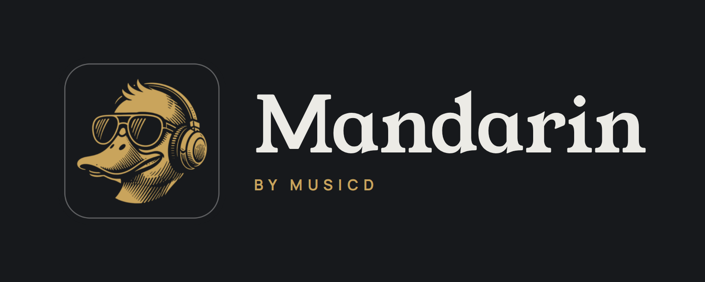

<div align="center">

<picture>
  <source media="(prefers-color-scheme: light)" srcset="docs/mandarin-logo-light.png">
  
</picture>

</div>

# Mandarin — v1.1.8

**Your own music files, played to Sonos rooms, to UPnP/DLNA renderers (a WiiM, a Chord Poly,
a streamer, an AV receiver) and to the Mandarin Android app.**

**📖 Install guide & command builder: [meltface-80.github.io/Mandarin](https://meltface-80.github.io/Mandarin/)**

A server on a machine you own scans your music folders and plays them to the players in your
house. You control it from a browser, an iPhone home-screen app or the Android app. No
subscription or streaming account is needed. Album names are looked up online (MusicBrainz,
Wikipedia, Deezer and others); your music files stay on your machine.

```
 browser / iPhone PWA / Android app ──HTTP──▶  Mandarin  ──Sonos UPnP──▶  Sonos rooms
                                                   │      ──UPnP AV / DLNA──▶  WiiM, Chord Poly, receivers, TVs
                                                   │      ──HTTP──▶  the Android app (phone, USB DAC)
                                                   └──── audio: /stream/… ◀────────┘
```

**New in v1.1.8** (since v1.1.7): **an account optional, and Mandarin on a TV.**
* **No account needed.** A TV showing the shelf or the wall display shouldn't need a username and password typed
  into it. A new install offers **Use without an account**; an existing one keeps asking for a sign-in until you
  switch it off in **Settings → Account → Ask for a sign-in** (the page and the Android app alike). Off, anything on
  your home network or your own Tailscale network comes straight in, each browser and app still a device of its own;
  from anywhere else a sign-in is still needed. See [Your account](#your-account).
* **Readable from the sofa.** On a big screen toasts follow your text size and grow with the screen, and the wall
  display's review and "More from" cards are twice the size on a 1920px TV.
* **The album beside the player.** On a desktop (a TV with a mouse) an album opens in the room beside the mini player,
  wherever you've dragged it, instead of under it.

---

## Features

<!-- features:start -->

Every feature below has an **ⓘ**: open it for how to switch the feature on and use it.

🏠 **Home**

Rows of albums under a greeting: Not played in 6 months, Listen later, Playlists, Favourites, Recently played, Smart Picks, Label of the week, Random albums, Library and Browse by genre.

<details><summary><b>ⓘ</b> How to set it up and use it</summary>

Open **☰ → Home**. Tap a row's title for all of it. To reorder rows or hide one, open **Settings → Setup → Home Screen**, hold a row's grip and drag it, or switch it off.

</details>

⸻

👆 **Phones and tablets**

On a touchscreen, either way round: a row at the foot (Menu, Home, Library, Artists, Search) under the mini player, and albums scrolling to the screen's top edge.

<details><summary><b>ⓘ</b> How to set it up and use it</summary>

Nothing to set up: a phone or tablet gets it in the browser, the iPhone home-screen app and the Android app; a computer with a mouse keeps the top bar. Tap Home or Library again to go back to the top; Search opens its field across the screen.

</details>

⸻

🎲 **Random Album**

The first tile under the greeting chooses an album you haven't played in 12 months (until Mandarin has 12 months of history, any album) and offers it to play.

<details><summary><b>ⓘ</b> How to set it up and use it</summary>

Choose where to play with the speaker button, then tap **Random Album**. Its disc turns while an album is chosen; then tap **Play now**, **Play next** or **Queue**, or close it.

</details>

⸻

📅 **Album of the day**

One album, the same on every device, chosen by the server at 00:01. Once played from any device, it's gone until the next 00:01.

<details><summary><b>ⓘ</b> How to set it up and use it</summary>

Nothing to set up: it sits beside Random Album on Home. 00:01 is in the server's time zone (`TZ` in the Docker command).

</details>

⸻

⏳ **Not played in 6 months**

Albums you haven't played in six months. The row stays hidden until Mandarin has six months of your listening.

<details><summary><b>ⓘ</b> How to set it up and use it</summary>

A Home row; tap its title for all of them. Move or hide it in **Settings → Setup → Home Screen**.

</details>

⸻

📚 **Library**

Every album, sorted by name, artist, release date, date added, plays, last played or random, and narrowed by genre, decade, label, format, sample rate, bit depth or first letter.

<details><summary><b>ⓘ</b> How to set it up and use it</summary>

Tap the **Library** row's title on Home, or **Library** in a phone's or tablet's row. **Sort** and **Focus** are in the top bar (at the top right on a phone or tablet); Focus also has *Added in the last* and *Listening* (never played, not in 6 or 12 months). **☰ → Random albums** opens a shuffled wall.

</details>

⸻

🗄️ **Shelf**

A record shop's shelf of your collection: covers or spines, A → Z by artist or album, narrowed by genre, artist letter and decade, or spun to land anywhere.

<details><summary><b>ⓘ</b> How to set it up and use it</summary>

Its switch is **Settings → Setup → Shelf** (off on a new install); off, it is off entirely and not offered. Open **☰ → Shelf**, `http://<server-ip>:3500/shelf`, or **Shelf ›** on the wall display. Swipe for one album, swipe and hold to keep turning, flick to spin; tap the front cover to turn the case over, and hold a track on its back to choose tracks; the bar then plays or queues those. The bar at its foot plays or queues the album in front, skips back and forward, pauses and sets the volume; the tabs at the edges fold the choices away and bring in the queue. Tap the order's name above the shelf (**A → Z by artist**) for **A → Z by album**; the Shelf keeps the one chosen.

</details>

⸻

🔍 **Search**

Albums, artists and labels as you type, and Qobuz's and Tidal's catalogues beside them: an album from either opens and plays whether or not it is in your library.

<details><summary><b>ⓘ</b> How to set it up and use it</summary>

Tap the magnifying glass in the top bar (in the row at the foot of a phone's or tablet's screen) and type. Labels show when Record labels is on. Signed in to Qobuz or Tidal (Settings → Services), the service's artists and albums follow the library's, from the Library wall's filter too; tap a cover for the album's page, an artist for their page.

</details>

⸻

💿 **Album pages**

Tracks, year and label, write-ups from Wikipedia and Qobuz, and Pitchfork's score where it reviewed the album. Step to the previous or next album of the row you came from.

<details><summary><b>ⓘ</b> How to set it up and use it</summary>

Tap any album. **Play Now** and **Queue** are on the page; **⋯** has Play Next, Shuffle, Radio, Listen later, Edit album and (in the Android app) Download. Swipe sideways, tap **‹ ›** or press ← → for the previous or next album. The track playing has a small disc turning beside its number. A classical album is set out as its works and movements, its composers and performers in its head.

</details>

⸻

🧭 **More by, and similar**

Under an album's review: the artist's other albums, the albums they appear on, and, with a Last.fm key, similar artists and albums. Ones in your library open here.

<details><summary><b>ⓘ</b> How to set it up and use it</summary>

Open any album. For the Last.fm rows, get a free key at last.fm/api/account/create and paste it in **Settings → Setup → API Keys** (or set `LASTFM_KEY`). Read-only: nothing is scrobbled.

</details>

⸻

🎤 **Artists**

Every act in your library as a round picture with their name and album count, in the album wall's columns, sorted A to Z, by most albums or at random.

<details><summary><b>ⓘ</b> How to set it up and use it</summary>

On a phone or tablet, tap **Artists** in the row at the foot of the screen. **Sort** is at the top right; **Search** in the row finds an artist by part of the name. Tap one for their page.

</details>

⸻

🧑‍🎤 **Artist pages**

Who they are, then their discography, the albums they appear on, similar artists and similar albums. Members fold under a heading. One artist however a sleeve credits them.

<details><summary><b>ⓘ</b> How to set it up and use it</summary>

Tap an artist's name on an album's page, on the Artists wall or in Search. Facts come from MusicBrainz, Wikidata and Wikipedia, pictures from FanArt.tv (with a key), Wikidata or Deezer, similar artists and albums from Last.fm (with a key) or Deezer. Tap **Members** to unfold a band's line-up. A member's page shows their bands' albums from their years in them; a tap on a member, a band or a similar artist opens theirs. Tap a genre for its albums.

</details>

⸻

👥 **Album credits**

Under an album's tracks: who played, sang, wrote and made it, each with their parts and the tracks they are on, from the files' tags and MusicBrainz.

<details><summary><b>ⓘ</b> How to set it up and use it</summary>

Nothing to set up: the server looks albums up in the background, a second at a time. Eight show at first; **More** for the rest. Tap a name for their artist page.

</details>

⸻

🎸 **Genres on pages**

An album's genres as small chips under its cover, and an artist's, the most used across their albums. A tap opens that genre's albums.

<details><summary><b>ⓘ</b> How to set it up and use it</summary>

Nothing to set up: they come from your files' genre tags. A genre written two ways (*Indie Rock*, *indie rock*) is one, spelled as most of your albums spell it.

</details>

⸻

✏️ **Edit album**

Correct an album's title, artist or year and choose its cover. Edits are kept in the server's database; your music files are not changed.

<details><summary><b>ⓘ</b> How to set it up and use it</summary>

On an album, tap **⋯ → Edit album**.

</details>

⸻

🗂️ **Music folders**

Any number of folders the server can see, added and removed in the app. Changes show by themselves where the file system reports them, otherwise at the next scan.

<details><summary><b>ⓘ</b> How to set it up and use it</summary>

Open **Settings → Music Folders** and add a folder from the list of drives and folders the server can see. A full scan runs every 6 hours (`SCAN_INTERVAL_HOURS`); **☰ → Rescan library** runs one now, then brings Qobuz and Tidal up to date, in that order, where you are signed in with the import on.

</details>

⸻

💽 **One album per folder**

Each folder is one album. Disc folders inside it, such as Disc 1 or CD2, make one album shown disc by disc, with a two-disc symbol on its cover.

<details><summary><b>ⓘ</b> How to set it up and use it</summary>

Nothing to set up.

</details>

⸻

📝 **Untagged files named from folders**

A file with no tags takes its artist, album, year, title and track number from its folder and file names. Nothing is written to your files.

<details><summary><b>ⓘ</b> How to set it up and use it</summary>

Nothing to set up. Those albums are then looked up by the Library Scanner like any other.

</details>

⸻

🏷️ **Every tag kept**

All of each file's tags are read into the server's database, including MusicBrainz IDs, barcode, catalogue number, ISRC and ReplayGain, and used to identify albums.

<details><summary><b>ⓘ</b> How to set it up and use it</summary>

Nothing to set up: tags are read with every scan.

</details>

⸻

🔎 **Library Scanner**

Names albums from their files' identifiers first, then from MusicBrainz by tracks and lengths, with Apple's iTunes catalogue as a second source. Measures ReplayGain for files without it.

<details><summary><b>ⓘ</b> How to set it up and use it</summary>

Open **Settings → Library Scanner**. **Clean up** there removes albums whose files are gone, after showing counts. Matches of 85% or better are applied (with Undo); the rest are left for you to match; a copy that is every track of a bigger pressing is taken as that record. Your files are not changed. **Ask iTunes too** and **Measure ReplayGain** are on the same page; **Scheduling** sets the hours both run, identification first, then ReplayGain album by album.

</details>

⸻

📦 **MusicBrainz pack**

An optional download of every MusicBrainz release with a barcode, about 2 GB on disk. Albums with a barcode are matched from it, also while musicbrainz.org is down.

<details><summary><b>ⓘ</b> How to set it up and use it</summary>

Open **Settings → Library Scanner → MusicBrainz pack** and tap **Download**. **Folder** chooses where it's kept; in Docker that folder needs a writable mount (see Install).

</details>

⸻

▶️ **Now playing**

Cover, track, transport, volume, the queue and history, and a badge saying what the device is being sent. An optional waveform seek bar is drawn from the audio.

<details><summary><b>ⓘ</b> How to set it up and use it</summary>

Tap the bar at the bottom of the screen. The waveform is off until you switch on **Settings → Audio Devices → Waveform**. On a large screen, Now playing can shrink to a card you drag around. On the Queue tab, hold a track to select it and more; **⋯** plays the selection now or next, or removes it; **Clear all** empties the queue.

</details>

⸻

↪️ **Move to another device**

Pick another room, renderer or phone while music plays and it moves there: the queue goes with it, from the same track and second.

<details><summary><b>ⓘ</b> How to set it up and use it</summary>

Tap the speaker button (on the bar or Now playing) and choose the device to move to.

</details>

⸻

📻 **Random Album Radio**

When a device's queue is running out, a random album goes on the end: never one the radio played in the last six months. Switched on per device.

<details><summary><b>ⓘ</b> How to set it up and use it</summary>

Open **Settings → Audio Devices**, tap the device and switch on **Random album radio**. **⋯ → Radio** on an album plays it and switches radio on for that device.

</details>

⸻

🔈 **Sonos**

Play, queue, play next, shuffle, repeat and volume for each Sonos room, and grouping and ungrouping rooms. Sonos plays up to 24-bit / 48 kHz; Mandarin converts anything above.

<details><summary><b>ⓘ</b> How to set it up and use it</summary>

Sonos rooms are found on the network by themselves (`SONOS_HOSTS` if not). Pick one with the speaker button; **Group zones…** in the same list groups them.

</details>

⸻

📡 **UPnP/DLNA renderers**

WiiM, Chord Poly, streamers, AV receivers and TVs on your network, played like a Sonos room. Tracks join gaplessly on a renderer that supports it.

<details><summary><b>ⓘ</b> How to set it up and use it</summary>

A renderer found on the network is off until you switch it on in **Settings → Audio Devices**. Then pick it with the speaker button. **Look again** searches the network now.

</details>

⸻

🖥️ **Sound devices on the server**

A USB DAC, speakers or HDMI on the computer Mandarin runs on, played like a Sonos room. Tracks at the same rate join with nothing between them.

<details><summary><b>ⓘ</b> How to set it up and use it</summary>

Plug it in, then switch it on in **Settings → Audio Devices**. In Docker, add `--device /dev/snd` and `--privileged`; on a Mac, nothing to add: it plays through Core Audio at each track's own rate. Details under [Sound devices on the server](#sound-devices-on-the-server).

</details>

⸻

🎚️ **Audio Devices**

Every room, renderer and phone with the rates, depths and formats it takes, your own name for it, and a switch. Renderers play Original or upsampled ×2, ×4 or Max.

<details><summary><b>ⓘ</b> How to set it up and use it</summary>

Open **Settings → Audio Devices** and tap a device. The name you give it is what the speaker list and Now playing show. **Output** is on a renderer's page. **Hide / unhide** takes devices you don't use off the list; tap it again and tick one under Hidden to bring it back.

</details>

⸻

💎 **DSD**

A renderer that says it takes DSD files is sent the DSF or DFF itself; others get PCM. A USB DAC on the phone gets DSD natively or as DoP.

<details><summary><b>ⓘ</b> How to set it up and use it</summary>

On a renderer's page in **Settings → Audio Devices**, switch the DSD rates it takes on or off.

</details>

⸻

🔊 **Volume Levelling**

ReplayGain per device: Off, Track, Album or Auto, a target from −14 to −25 LUFS, and a level for tracks with no loudness information.

<details><summary><b>ⓘ</b> How to set it up and use it</summary>

Open **Settings → Audio Devices**, tap the device, and set **Volume levelling** (above DSP). Auto plays albums at album level and mixed tracks at track level.

</details>

⸻

🎛️ **DSP**

A parametric EQ of up to ten bands per renderer or phone, its curve drawn as you edit, plus headphone profiles from AutoEq or a pasted ParametricEQ.txt.

<details><summary><b>ⓘ</b> How to set it up and use it</summary>

Open **Settings → Audio Devices**, tap a renderer or the phone, and switch on **DSP**. Sonos rooms have no DSP here.

</details>

⸻

⚙️ **Playback first**

Playback keeps a processor core of its own, two while DSP is in use. Scanning, ReplayGain and downloads run on the other cores, at the lowest priority.

<details><summary><b>ⓘ</b> How to set it up and use it</summary>

Nothing to set up on Linux. **Settings → Library Scanner → Processor** shows the split. In Docker, `--cap-add SYS_NICE` also raises playback's priority. `PLAYBACK_CORES` sets how many cores playback keeps; 0 shares them all.

</details>

⸻

⭐ **Smart Picks**

Five albums a day from your own library, by artists Deezer lists as related to the ones you've played, topped up from your least-played albums.

<details><summary><b>ⓘ</b> How to set it up and use it</summary>

**☰ → Smart Picks**, or its Home row. **Settings → Setup → Smart Picks** switches it on or off and sets the hour each day's picks are made.

</details>

⸻

📰 **Pitchfork**

Pitchfork's latest album reviews and Best New Music, read in the app, with Play on any album you own.

<details><summary><b>ⓘ</b> How to set it up and use it</summary>

Open **☰ → Pitchfork**.

</details>

⸻

🏢 **Record labels**

Labels from your files' tags or a folder level: a Labels screen, logos from Discogs and FanArt.tv, lookups for albums without a label, and merging of duplicate names.

<details><summary><b>ⓘ</b> How to set it up and use it</summary>

Switch it on in **Settings → Setup → Record labels**. Logos need a Discogs token or FanArt.tv key (**Settings → Setup → API Keys**). On **☰ → Labels**, search and #–Z are in the top bar (on a phone or tablet, #–Z at the top right and Search in the row); hold a tile to select labels to merge.

</details>

⸻

📆 **Label of the week**

With Record labels on, one label from your library on Home all week, with its albums. A new one each Monday.

<details><summary><b>ⓘ</b> How to set it up and use it</summary>

Switch on **Settings → Setup → Record labels**; the row then shows on Home.

</details>

⸻

❤️ **Favourites**

A heart on every album. Hearted albums gather on a Home row.

<details><summary><b>ⓘ</b> How to set it up and use it</summary>

Tap the heart on an album's page. Tap the **Favourites** row's title for all of them.

</details>

⸻

🕒 **Listen later**

Albums put aside to play another time, on a Home row and a screen of their own. Each comes off by itself once every track has been played.

<details><summary><b>ⓘ</b> How to set it up and use it</summary>

On an album, **⋯ → Listen later**, or select several on a wall. Open the list from **☰ → Listen later**.

</details>

⸻

🎵 **Playlists**

Playlists you make, and Dynamic Playlists that follow a saved Library view. A playlist can be shared as text and imported, matched against the other library's tracks.

<details><summary><b>ⓘ</b> How to set it up and use it</summary>

**☰ → Playlists**, **☰ → Dynamic Playlists** and **☰ → Import a playlist**. A playlist's **Share** gives the text to send.

</details>

⸻

🖼️ **Share card**

The album as a picture, the duck in its corner, links to hear and read about it, and three acts near what you play, two of them new to you.

<details><summary><b>ⓘ</b> How to set it up and use it</summary>

Tap the share button on an album's page. Choose the services in **Settings → Setup → Share Card**. In the Android app, **Download** saves the card to Pictures/Mandarin.

</details>

⸻

📺 **Wall display** — *new in v1.1.8*

A full-screen now playing page for a TV or tablet; on a big TV its reviews and covers are drawn large enough to read from across the room.

<details><summary><b>ⓘ</b> How to set it up and use it</summary>

Open `http://<server-ip>:3500/display` on the screen. Its switch (on by default) and options are in **Settings → Setup → Wall Display**; off, it is off entirely. Tap the screen for its controls; **Shelf ›** opens Shelf.

</details>

⸻

📱 **The Android app**

Mandarin's interface drawn natively by the app, which finds the server home or away and asks again when it's back; lock-screen controls, volume keys, a widget, Android Auto, its updates.

<details><summary><b>ⓘ</b> How to set it up and use it</summary>

Download [mandarin-android.apk](https://github.com/meltface-80/Mandarin/raw/main/dist/mandarin-android.apk) and install it (Android 8.0 or newer). Enter the port; it finds the server on your Wi-Fi.

</details>

⸻

🎧 **This phone**

The phone is a player of its own: speaker, headphones or Bluetooth, with queue, history and radio. At home, your other devices can play to it while the app runs.

<details><summary><b>ⓘ</b> How to set it up and use it</summary>

In the Android app, pick **This phone** with the speaker button.

</details>

⸻

🔌 **USB DAC on the phone**

The app's own USB Audio driver plays to a DAC on the phone's port at the file's rate and depth, without Android's mixer; DSD natively or as DoP.

<details><summary><b>ⓘ</b> How to set it up and use it</summary>

Plug the DAC in. It shows on **This phone**'s page in **Settings → Audio Devices**; switch on **USB direct** there.

</details>

⸻

⬇️ **Downloads**

Albums kept on the phone as the original files or Opus 256, played without the server. Smart Picks, the Album of the day and new albums can download by themselves.

<details><summary><b>ⓘ</b> How to set it up and use it</summary>

On an album, **⋯ → Download to this phone**. Quality, the download folder, Wi-Fi only and automatic downloads are in **Settings → Setup → Downloads** in the app.

</details>

⸻

📂 **Music on this phone**

A folder of music already on the phone, watched for changes, on Home with Focus and Sort and on artists' pages, played like the library. The server never sees it.

<details><summary><b>ⓘ</b> How to set it up and use it</summary>

In the app, **Settings → Music Folders → On this phone** and choose the folder. Selected with other albums and played on **This phone**, they go into the one queue.

</details>

⸻

✈️ **Offline mode**

One switch: only the music on the phone shows, and the server isn't used. With no connection the app does the same by itself, and reconnects when it can.

<details><summary><b>ⓘ</b> How to set it up and use it</summary>

In the Android app, **☰ → Offline mode**. While offline, a small *Offline* pill sits at the top of the screen: tap it to see why (Offline mode, or the server can't be reached).

</details>

⸻

🌍 **Away from home**

On mobile data the app reaches the server through its own Tailscale, by itself, with no ports opened. Away, only the phone plays: Opus 256 or original files.

<details><summary><b>ⓘ</b> How to set it up and use it</summary>

**Settings → Setup → Away from home** on the server: **Sign in to Tailscale**. Then in the app, the same page: **This phone**. Open the app once at home. Details under [Away from home](#away-from-home-tailscale).

</details>

⸻

🎨 **UI Settings**

Text sizes, grid layout (Auto, 3 or 2 columns, or List) and tile size, saved on each device. On a desktop, text goes up to +100%.

<details><summary><b>ⓘ</b> How to set it up and use it</summary>

Open **Settings → Setup → UI Settings** and pick from each list; it applies at once.

</details>

⸻

👤 **An account, or none** — *new in v1.1.8*

One username and password kept on the server, or none: a TV showing the shelf or the wall needs nothing typed. The password itself is never sent.

<details><summary><b>ⓘ</b> How to set it up and use it</summary>

On first visit from a device at home, create the account or choose **Use without an account**. **Settings → Account → Ask for a sign-in** switches it on or off: off, the home network and your Tailscale network come straight in, anywhere else still signs in. Details under [Your account](#your-account).

</details>

⸻

⏻ **Restart and shut down**

Restart Mandarin, or shut it down so it stops finding and controlling your speakers until you start it again. In Docker, only Restart.

<details><summary><b>ⓘ</b> How to set it up and use it</summary>

Open the side menu (☰) and tap the **power button** in its top-right corner, then **Restart** or **Shut down**. On a Mac, double-click **Mandarin** on the desktop to start it again. In Docker: `docker stop musicd-server`, then `docker start musicd-server`.

</details>

⸻

💾 **Backup and restore**

Back up settings, players, collection, API keys (with the Tailscale identity) and the whole database, at home or away: to the server, or from the app to a file.

<details><summary><b>ⓘ</b> How to set it up and use it</summary>

Open **Settings → Backup & restore**, tick what to include, then **Back up to the server** (or, in the app, **Back up to a file on this phone**). To restore, pick a backup (or the file), tick the parts and tap **Restore**. Mandarin keeps a backup of how things were first, then restarts.

**What a backup holds.** The API keys part (and the whole database) holds your Discogs, FanArt.tv and Last.fm keys, the Qobuz and Tidal sign-ins (tokens, never a password) and the server's Tailscale identity. Without a passphrase they are in the file as they are, so keep the file as you would keep them. Type a **passphrase** (8 characters or more) before backing up and they are sealed (AES-256-GCM; v0.9.0): restoring them asks for it, and nothing opens them without it. Everything else in a sealed backup restores without it. A backup never holds your password or other devices' sign-ins.

</details>

⸻

🎼 **Qobuz**

Sign in with your Qobuz subscription: your favourites and purchases become albums here, and the Qobuz browser plays anything in the catalogue, streamed through the server.

<details><summary><b>ⓘ</b> How to set it up and use it</summary>

**Settings → Services → Qobuz**: sign in. Then **☰ → Qobuz** to search and play; **+** on a cover adds an album to your Qobuz favourites (a **✓** once added) and so to the library, as does **⋯ → Add to Qobuz favourites** on its page. Details under [Qobuz](#qobuz).

</details>

⸻

🎵 **Tidal**

Sign in with your Tidal subscription on tidal.com: your favourite albums become albums here, and the Tidal browser plays anything in the catalogue, streamed through the server.

<details><summary><b>ⓘ</b> How to set it up and use it</summary>

**Settings → Services → Tidal → Sign in on tidal.com**: open the link, sign in there, come back. Then **☰ → Tidal** to search and play; **+** on a cover adds an album to your Tidal favourites (a **✓** once added) and so to the library, as does **⋯ → Add to Tidal favourites** on its page. Details under [Tidal](#tidal).

</details>

⸻

📝 **Logging**

Off by default. Switched on, the Android app and the server log what happened, without personal data, for you to send to the developer when something goes wrong.

<details><summary><b>ⓘ</b> How to set it up and use it</summary>

In the Android app, **Settings → Setup → Logging**. Use the app as you normally would for 24 hours, then tap **Save log** (it goes to Downloads/Mandarin) and send the file. Look through it first. Switching logging off deletes the log, the server's part too. Details under [Logs](#logs).

</details>

⸻

🔄 **Updates**

The server updates itself from GitHub from Settings and checks every 12 hours. In the Android app one Update does the server first, then the app.

<details><summary><b>ⓘ</b> How to set it up and use it</summary>

**Settings → Updates → Check for updates**, then **Update to vX.Y.Z**. The server puts the new version in place and starts again in a few seconds; in the app, Android's installer then asks.

</details>

<!-- features:end -->

## What each device is sent

Each track goes the way the device can take it. The Now playing badge says what was sent.

* **Sonos** plays up to 24-bit / 48 kHz. Within that, the file as stored. Above it, or in a
  format Sonos can't read, FLAC at 24/48.
* **A UPnP/DLNA renderer** has its own ceiling, read from the device. Within it, the file as
  stored; above it, FLAC at the highest rate the device takes in the file's family; upsampled
  ×2, ×4 or to the device's maximum if you choose. DSD goes as the DSF or DFF file itself to a
  device that says it takes DSD files (DSD rates switchable on its page), as PCM otherwise.
* **The Android app** on the phone's own output: the file as stored within 24/48, FLAC 24/48
  above it; away from home, Opus 256 by default.
* **A USB DAC on the phone**, with USB direct on: the file at its own rate and depth where the
  DAC takes it, DSD natively or as DoP, FLAC at the DAC's highest rate otherwise.
* **Formats nothing plays as they are** — APE, WavPack, WMA Lossless, 24-bit WAV, more than two
  channels — become FLAC, in stereo.

Conversion is ffmpeg with the SoX resampler and triangular dither. A converted track is written
to a cache as it plays, so the device starts on the first frames, and the next tracks in the
queue are prepared ahead. Replays come from the cache (4 GB by default, least recently played
removed first).

## Install (Docker)

Run it on an always-on Linux machine on the same network as your speakers — a NAS, a
Raspberry Pi 4/5 (64-bit OS), a home server.

If Docker isn't installed yet:

```bash
dietpi-software install 162              # DietPi (162 is its Docker package)
curl -fsSL https://get.docker.com | sh   # Debian, Ubuntu, Raspberry Pi OS
```

Then:

```bash
docker stop musicd-server 2>/dev/null; docker rm musicd-server 2>/dev/null
docker pull ghcr.io/meltface-80/musicd-server:latest

docker run -d \
  --name musicd-server \
  --network host \
  --restart unless-stopped \
  -e TZ=Europe/London \
  -v musicd-server-data:/app/data \
  -v /your/path/to/Music:/music:ro \
  -v /mnt:/mnt:ro,rslave \
  ghcr.io/meltface-80/musicd-server:latest
```

Open **`http://<server-ip>:3500`**. The first scan runs straight away; a big library takes a
few minutes and albums appear as it goes.

> **`--network host` is required.** Sonos players are found by multicast, which does not
> cross Docker's default bridge network — and the speakers fetch audio from this machine's
> own address. Docker Desktop on macOS/Windows has no real host networking, so this needs a
> Linux host. On a Mac, install it without Docker: see [Install on a Mac](#install-on-a-mac).

> **Keep the `musicd-server-data` volume.** It holds the library database, play history,
> playlists, settings and the artwork and transcode caches. Point every future `docker run`
> at the same name.

**The MusicBrainz pack on another drive (optional).** The pack (Settings → Library Scanner) is
2 GB, kept in the data volume unless you choose a folder. To keep it on another drive, add a
writable mount — no `:ro` — to the command above, e.g.:

```bash
  -v /mnt/dietpi_userdata/1tb/mandarin:/packs \
```

then choose `/packs` under **Folder** on that page. Keep the line in every future `docker run`
(an update included): without it `/packs` isn't there, and the page says so. A folder reached
through the read-only `-v /mnt:/mnt:ro,rslave` mount can't be used for the pack.

**A USB DAC or speakers on this machine (optional).** To play through sound devices plugged into
the machine Docker runs on, add these two lines to the command above:

```bash
  --device /dev/snd \
  --privileged \
```

`--device /dev/snd` hands the sound devices to the container; `--privileged` lets the container
open them, which on most hosts it otherwise can't (the device nodes belong to the host's `audio`
group), and lets playback run at a higher priority. They then appear in **Settings → Audio Devices**. A container already running needs
re-creating with the lines (stop, rm, the `docker run` again — the data volume carries everything
over). See [Sound devices on the server](#sound-devices-on-the-server).

**Music folders, chosen in the app.** Mount your drives or shares into the
container once — e.g. `-v /mnt:/mnt:ro,rslave` — then add any folders inside them in
**Settings → Music Folders**, as many as you like, and remove them there too. The folder
picker lists every drive and share the server can see.

> **DietPi (and any network share mounted on demand):** DietPi-Drive_Manager mounts USB
> drives and network shares under `/mnt`, and mounts shares only when they're first opened.
> A container started with a plain `-v /mnt:/mnt:ro` never sees those later mounts — the
> folder looks empty. End the line with **`,rslave`** (`-v /mnt:/mnt:ro,rslave`) so mounts the
> machine makes afterwards reach the server too, then re-create the container. Music Folders
> says so when it spots a share it can't see. `/music` is
the first folder until you change the list. A folder that goes missing for a while (a drive
asleep, a share that dropped, part of it unreadable, most of it gone at once) keeps its
albums; the page says so and offers to forget it.

A `docker-compose.yml` is in the repository: set your music path and `docker compose up -d`.

### Build it yourself instead

```bash
git clone https://github.com/meltface-80/Mandarin.git
cd Mandarin
docker build -t musicd-server:local .
# then the docker run above, with musicd-server:local as the image
```

### Updating

**In the app:** Settings → **Updates** → **Check for updates** → **Update to vX.Y.Z**. The server
downloads the new release from GitHub, swaps it in and restarts itself in a few seconds;
a browser's page reloads on its own. In the Android app the same button then updates the app, once
the server is back (v0.7.3). It also checks twice a day and shows a banner when a new
version is out. (From v0.1.3 on — an older container needs one update the manual way.)

Since v0.9.0 Mandarin's server is one program, in C#, with no Node.js anywhere. An update from
the app fetches that program of the new version for your machine (x64 or ARM64) from the
release, checks it against the release's sums, puts it and the new page in place, and starts
again in the same container — a few seconds. If it can't start again in place, it stops and
Docker's restart policy (`--restart unless-stopped`, as above, or `restart: unless-stopped` in
`docker-compose.yml`) starts the container again; without one, start it yourself (`docker start
musicd-server`).

**Manually** — also the way to pick up changes to the image itself (ffmpeg, the audio engine,
and the move to v0.9.0 from an image with Node.js in it):

```bash
docker pull ghcr.io/meltface-80/musicd-server:latest
docker stop musicd-server && docker rm musicd-server
# re-run the docker run command above — the data volume carries everything over
```

## Install on a Mac

Mandarin runs on a Mac without Docker: macOS 14 or newer, Apple silicon or Intel. The Mac needs to
stay on, on the same network as your speakers.

**1. Open Terminal**: press Command-Space, type **Terminal** and press Return.

**2. Paste this line** and press Return:

```bash
/bin/bash -c "$(curl -fsSL https://raw.githubusercontent.com/meltface-80/Mandarin/main/tools/mac/install.sh)"
```

**3. Answer what it asks:**
* **Your Mac's password**, if it asks (for Homebrew, the Mac's package installer): type it and press
  Return. Nothing shows as you type; that's normal.
* **Your music folder**: a Finder window opens. Click the folder your music is in (on the Mac or on
  an external drive) and click **Choose**.
* **The MusicBrainz pack**: where to keep it, if you download it later (optional, about 2 GB).
  **On this Mac** is fine; **Choose a folder...** to put it on another drive.
* **Keep this Mac awake**: choose **Keep awake** so the music doesn't stop when the Mac would sleep.
* **Allow** if macOS asks to let **mandarin-server** find devices on your network or open your
  files. Mandarin needs both to reach your speakers and read your music.

**4. Done.** Mandarin opens in your browser: create your account, or choose **Use without an account**. It starts by itself every time you
log in. On a phone, open the address Terminal shows at the end (`http://<mac-ip>:3500`).

**On a Mac, as on Linux:**
* **Updates** come from the app (Settings → **Updates**): the new version's server for your Mac,
  checked against the release's sums, then started in place.
* **A USB DAC** plugged into the Mac: in **Settings → Audio Devices**, switch it on. Mandarin plays it
  through Core Audio at each track's own rate, holding it while it plays so nothing else is mixed in.
* **Away from home**: **Settings → Away from home** turns on Mandarin's built-in Tailscale, as on Linux.
* **Shut down and start again:** the **power button** at the top right of the side menu (☰) →
  **Shut down** stops Mandarin; double-click **Mandarin** on the desktop (or in your Applications
  folder) to start it again. It also starts when you log in.
* **Your data** (library, history, playlists, settings) is kept in `~/Mandarin/data`.
* **No albums?** macOS may be keeping Mandarin out of the folder. In System Settings → Privacy &
  Security → **Full Disk Access**, click **+**, press Command-Shift-G, paste
  `~/Mandarin/server/bin/mandarin-server`, and click **Open**.
* **Stop Mandarin starting at login:** `launchctl unload ~/Library/LaunchAgents/app.mandarin.server.plist`

## Configuration

Everything is optional; pass any of it with `-e NAME=value`.

| Variable | Default | Purpose |
| --- | --- | --- |
| `PORT` | `3500` | The web interface, the API, and where speakers fetch audio. |
| `TZ` | UTC | Your time zone — Album of the day changes over at 00:01 and Smart Picks at local midnight. |
| `SONOS_HOSTS` | — | A speaker's IP (comma-separated for several), for when multicast discovery is unreliable. One is enough. |
| `UPNP_HOSTS` | — | UPnP/DLNA renderers to ask by address (an IP, or a description URL like `http://192.168.1.50:49152/description.xml`), for when multicast discovery misses them. |
| `SERVER_IP` | auto | The address speakers fetch audio from. Auto picks the machine's LAN address, skipping VPN, Docker and VM interfaces, and searches for speakers on every LAN interface. Set it to pin one. |
| `INCLUDE_ZONES` | — | Offer only these rooms, e.g. `Kitchen,Study`. |
| `EXCLUDE_ZONES` | — | Offer every room except these. |
| `SCAN_INTERVAL_HOURS` | `6` | How often the music folders are re-checked in full (only changed files are re-read). Changes are also noticed as they happen through the file system's own notifications, where it gives them — a network share changed from another machine waits for this. Rescan any time from the menu. |
| `TRANSCODE_CACHE_GB` | `4` | Disk kept for converted tracks. An upsampled track is several times a CD-rate one: with upsampling on, 16 is a better number. |
| `TRANSCODE_CONCURRENCY` | `2` | How many tracks are converted at once. |
| `PLAYBACK_CORES` | auto | Processor cores kept for playback alone: one, or two while DSP is in use. `1` or `2` fixes the number; `0` shares every core. *Settings → Library Scanner → Processor* shows the split. |
| `MUSIC_DIR` | `/music` | Where the library is mounted inside the container. |
| `TS_AUTHKEY` | — | Sign the server's built-in Tailscale in with an auth key instead of from *Settings → Setup → Away from home*. |
| `TS_HOSTNAME` | `musicd` | The server's name on your tailnet. |
| `TAILSCALE` | on | `off` leaves the built-in Tailscale out (Tailscale on the host still works). |
| `LOCAL_AUDIO` | on | `0`: leave this computer's sound devices out of *Settings → Audio Devices*. See [Sound devices on the server](#sound-devices-on-the-server). |
| `TAILSCALE_ADDRESS` | auto | The server's address away from home, if the one found on the host's `tailscale0` isn't the one to use — an IP, a MagicDNS name, or a full `https://` address. See [Away from home](#away-from-home-tailscale). |
| `MUSICBRAINZ_URL` | musicbrainz.org | Another MusicBrainz web service (a mirror) for the identification scan, release days and an album write-up's year. |
| `IDENTIFY` | on | `0` leaves the identification scan out entirely. |
| `MBPACK_DIR` | data folder | Where the MusicBrainz pack is kept (Settings → Library Scanner); overrides the folder chosen there. |
| `ITUNES_COUNTRY` | US | The Apple store the identification scan's iTunes lookups use (`GB`, `DE`…). |
| `AUTOEQ_URL` | GitHub | Where AutoEq's results are read from for headphone profiles (Settings → Audio Devices → a device → DSP). |
| `LASTFM_KEY` | — | A Last.fm API key for similar artists and albums on album and artist pages, until one is saved in *Settings → Setup → API Keys* (which then wins). |
| `DEBUG` | — | Log every API call. |

Settings for the FanArt.tv key (artist photos, on artist pages and the wall display), waveform, share-card services, Smart Picks,
the wall display and the Home rows are in the app's Settings and are saved in the data volume.

## Your account

Mandarin has **one account**, kept on the server itself — nothing online — or, if you'd rather, none
(v1.1.8). On a new install the server does nothing until you choose:

1. Open `http://<server-ip>:3500` on a device **on your home network** (a browser, the iPhone
   home-screen app, or the Android app) and choose a username and password, **or** tap
   **Use without an account**.
2. With an account, every other device signs in with it once and is remembered.
3. **Settings → Account** lists every device, with a *Sign out* button for each, and changes the
   password.

**Ask for a sign-in** (*Settings → Account*, on the page and in the Android app) switches the
sign-in on or off. An install that had an account before v1.1.8 keeps asking until you switch it
off. Off, anything on your home network or on your own Tailscale network (100.64.0.0/10) comes
straight in: a TV showing the shelf or the wall needs nothing typed. Each browser and app is still
a device of its own, listed in *Settings → Account*. From anywhere else (a port forwarded to the
internet) a sign-in is still needed, and with no account there is none to give. Switching it on
with no account asks you to create the account first; devices already in stay in until you sign
them out.

The password never crosses the network, even on plain http: devices prove they know it with
SRP (the scheme Apple uses for HomeKit pairing), and the server proves it knows the account
back. The server stores only an SRP verifier, never the password.

**Forgot the password?** On the server run

```bash
docker exec musicd-server /app/server/bin/mandarin-server reset-password
```

It removes the account and signs every device out; your library, edits, playlists and history
stay. Then create the account again from a device at home.

Sonos speakers can't sign in: the addresses they're given carry a signature, and the speakers'
own addresses are let through, so playback is unaffected.

## iPhone and iPad

Open `http://<server-ip>:3500` in Safari, tap **Share → Add to Home Screen**. It opens full
screen like an app, with the same interface as the Android app.

## Android

The app is in **[android/](android/)**, a native app (Kotlin and Jetpack Compose). Enter the port (3500 unless you changed it) and it finds
the server on your Wi-Fi, or type the address; then sign in, or create the account on a new
server (or use it without one), in the app. With the sign-in switched off, it goes straight in. Its features are listed under [Features](#features).

**Download: [mandarin-android.apk](https://github.com/meltface-80/Mandarin/raw/main/dist/mandarin-android.apk)**
— the newest build, published by GitHub Actions on every version merged to `main`. Sideload it
on Android 8.0 or newer. The build itself is named `Mandarin-Android-<version>.apk` (since
v0.9.7); this link keeps one name so it always points at the newest.

**Updates install over the top.** From v0.6.10 the published app is a release build signed with
the project's own private key, and every update after it installs in place.

**Coming from a build before v0.6.10?** Those were signed with a different, shared key, so
Android refuses the update ("conflicts with an existing package"). Uninstall the app once,
install [mandarin-android.apk](https://github.com/meltface-80/Mandarin/raw/main/dist/mandarin-android.apk),
open it, enter the server's address and sign in again. Albums downloaded to the phone go with
the uninstall, so download them again. After that, never again.

**Building the app yourself?** Without the `MUSICD_KEYSTORE_BASE64` and
`MUSICD_KEYSTORE_PASSWORD` secrets, a build is signed with the shared key committed here
(`android/app/musicd-debug.keystore`) and named `…-shared-key.apk`. It can't update the
published app, nor the published app it.

## Qobuz

Mandarin streams from Qobuz with a Qobuz subscription (v0.6.23), the way the Lyrion Music
Server's Qobuz plugin does — the same API, the same credentials, the same rules. Experimental,
in line with Qobuz's terms of service; those who use it do so at their own risk.

* **A subscriber signs in** (*Settings → Services → Qobuz*). Mandarin keeps the sign-in token, never
  the password. Qobuz decides what the account may stream.
* **Your favourites and purchases are albums here** — every one, brought up to date shortly after
  signing in, every six hours, and when you add a favourite: on the walls, in search, Smart Picks,
  Listen later and playlists, with a Qobuz mark on the cover. *Favourites and purchases in the
  library* on the Services page switches this off.
* **Favourites follow both ways, by themselves** (v0.7.3). Remove an album from your Qobuz
  favourites here and it is gone from Qobuz and off the walls within the moment; add one and it
  is on them. A favourite added or removed in the Qobuz app follows here on the next look: the
  server checks every two minutes, and the page checks when you come back to Home or the Library
  wall. An album's page says why it is in the library — a favourite or a purchase since a date, a
  playlist's, or only played — and its release date when it is not out yet.
* **The Qobuz browser** (*☰ → Qobuz*): search, new releases, best sellers, most streamed, press
  awards, editor's picks, an artist's albums, as the album grid the rest of Mandarin draws, each
  cover with its **+** for your Qobuz favourites. Tapping an album opens its page here, the same
  page as any album: Play now, Play next, Queue, or from a track, to the zone chosen. An album
  played without being kept is known here for a month (its page, Now playing, history) and stays
  off the walls.
* **Your Qobuz playlists and favourite tracks are playlists here**: each playlist by its Qobuz name,
  and *Qobuz favourite tracks*, on the Playlists screen, brought up to date with the library. The
  albums their tracks come from are known (the tracks play, Now playing has the cover) but stay
  off the walls unless they're favourites.
* **Signed out, it all steps aside**: Qobuz albums and playlists leave the walls and the Playlists
  screen while their rows stay, so signing in puts everything straight back. **Clean up** on the
  Library Scanner page removes what's no longer wanted — Qobuz albums not in your favourites,
  purchases or playlists (all of them while signed out), and, separately, albums whose files are
  gone from the server — after showing you the counts; plays stay in history.
* **Two favourites, kept apart.** The **+** on a Qobuz album's cover in the browser (a **✓** once
  added), and **Add to Qobuz favourites** / **Remove from Qobuz favourites** in the ⋯ menu on the
  album's page here, are your *Qobuz* favourite, and that is what puts the album in the library.
  The **heart** is Mandarin's own favourite, as on any album.
* **Every track is streamed through the server**: when a player comes to fetch it, Mandarin asks
  Qobuz for that one track (a signed request, as Qobuz requires) and feeds the player from its
  transcode cache — a Sonos room gets 24/48 at most, a streamer or a USB DAC what it takes, the
  phone what its DAC takes, with DSP and Volume Levelling as for a file. The next track is made
  ready behind the one playing, so albums play gaplessly. *Stream quality* on the Services page
  sets the most asked for (CD, Hi-Res 24/96, Hi-Res 24/192); the subscription sets the ceiling.
* **Every play is reported to Qobuz** (its streaming start and end), as Qobuz's own apps report
  them, so artists are paid. **Nothing is downloaded**: a Qobuz album has no *Download to this
  phone*, no *Edit album*, no waveform, and is not in offline mode; the cache holds only what the
  queue needs, pruned as the cache fills, and plays nothing once the account is signed out.

The app id and secret are the ones the Lyrion plugin carries, as Qobuz answers no application
requests; Qobuz leaves that plugin be because of how it behaves, and Mandarin behaves the same.

## Tidal

Mandarin streams from Tidal with a Tidal subscription (v0.6.24), the way the Lyrion Music
Server's Tidal plugin does — the same API, the same credentials, the same rules — and Tidal
albums live in Mandarin exactly as Qobuz albums do (above): the walls, the browser, playlists,
Clean up, the two favourites, the server's transcode cache, nothing downloaded. Experimental, in
line with Tidal's terms of service; those who use it do so at their own risk.

* **A subscriber signs in on tidal.com** (*Settings → Services → Tidal → Sign in on tidal.com*):
  Mandarin shows a link and a code, you sign in there on any device, and Mandarin notices by
  itself. It keeps the sign-in token, renewed as Tidal requires, never a password.
* **Your favourite albums are albums here**, every one, with a Tidal mark on the cover;
  *Favourites in the library* on the Services page switches this off. **Your Tidal playlists and
  favourite tracks are playlists here**, as with Qobuz. **Favourites follow both ways, by
  themselves** (v0.7.3), as with Qobuz: removed here, gone from Tidal and the walls at once;
  changed in the Tidal app, here on the next look (two minutes, or when you come back to Home).
* **The Tidal browser** (*☰ → Tidal*): search, new releases, recommended, top, rising, an
  artist's albums, as the album grid, each cover with its **+** for your Tidal favourites; an
  album opens on its page here. The ⋯ menu on a Tidal album's page has **Add to Tidal
  favourites** / **Remove from Tidal favourites**.
* **The stream.** *Stream quality* on the Services page is CD (FLAC 16/44.1) or Hi-Res: Tidal's
  hi-res FLAC, up to 24/192, where an album has it and the subscription allows. Tidal sends
  hi-res as MPEG-DASH (an initialisation piece and numbered segments), which the server joins
  into one stream for ffmpeg on its own loopback; where Tidal answers a hi-res ask with anything
  else, CD quality is asked for instead. What Tidal actually streams a track at is learnt the
  first time it is played and the album's badge corrected. Tidal has no play reports.

The client id and secret are the ones the Lyrion plugin carries, as Tidal's developer programme
answers no streaming requests; Tidal leaves that plugin be because of how it behaves, and
Mandarin behaves the same.

## Sound devices on the server

A USB DAC, the speakers or HDMI on the computer Mandarin runs on can be played to like a Sonos
room (v0.6.18).

1. Plug the DAC in. Within 30 seconds (or after **Look again**) it is listed in
   *Settings → Audio Devices*, off. Switch it on; it is then in the speaker list.
2. On its page: the rates it takes (a USB DAC on Linux lists its own; tap to change), **Output**
   (Original, ×2, ×4, Max), **Fixed volume**, **Volume levelling** and **DSP**, as for a renderer.

How it plays (v0.8.0, Linux): **Mandarin's audio engine** (`engine/`, a native program written
in C#) holds the device open. ffmpeg decodes each track straight into the engine's own buffer, up
to a few minutes ahead, and a thread of the engine's own writes it to the device through ALSA. The
next track at the same rate goes into the open device with nothing between them; a track at another
rate reopens it. Where the device is in a track is read from ALSA itself. The image carries the
engine; an install updated from Settings downloads it once. `AUDIO_ENGINE=0` plays as before
v0.8.0: ffmpeg decodes each track and a second ffmpeg holds the device open. Mandarin's slider scales the samples on a curve of 50 dB (100% leaves them untouched);
with **Fixed volume** on they are never scaled and the volume is the DAC's or amplifier's.

* **Linux:** ALSA, opened as `plughw:CARD=<name>,DEV=<n>`, so a DAC on another USB port is the
  same device. ALSA converts the 32-bit samples to the depth the device takes. While a track
  plays, ALSA's own report of the rate is compared with what was sent; a match is marked ✓.
  The user Mandarin runs as must be in the `audio` group. A device another program (PipeWire,
  PulseAudio) holds is reported as in use.
* **Docker:** add `--device /dev/snd` and `--privileged` to `docker run` (in `docker-compose.yml`,
  the commented `devices:` and `privileged:` lines), then re-create the container.
* DSD files go to these devices as PCM.
* **Playback comes first (v0.8.13).** The decoder and the device each queue a minute of audio
  ahead. On Linux with three cores or more, playback keeps a core of its own, or two while DSP is in
  use (the last ones), and both servers run on the others; on four cores, one for playback and
  three for the rest, or two and two. Scanning, measuring ReplayGain, the tag reader check and the
  phone's downloads run at the lowest priority, their disk reads last; conversions made ahead of
  play run just below playback. *Settings → Library Scanner → Processor* shows the split.
  `PLAYBACK_CORES=1` or `2` fixes how many cores playback keeps, `0` shares every core;
  `PLAYBACK_CORE=<n>` picks the core. With `--privileged`, `--cap-add SYS_NICE` (or as root) the
  engine and its decoder also run at a higher priority, and the engine's playback thread at a
  real-time one. An ALSA underrun, should one happen, is logged with what the feed was waiting for.

From [Music Assistant](https://github.com/music-assistant)'s Local Audio Out: the volume curve, ids
taken from the device's name, and a device that fails being reported and let go.

## Away from home (Tailscale)

Leave the house and the Android app keeps working over mobile data: the phone is
the only thing it plays to. No ports are opened on your router — the phone reaches the server
over [Tailscale](https://tailscale.com), a private network between your own devices.

**Away, only the phone plays.** Whatever reaches the server from outside your home network —
Tailscale included — is offered one room: the phone asking, as *This phone*. The Sonos rooms
aren't listed, and nothing away can play to them, pause, group or mute them, or reach another
phone. The server decides this by where each request comes from, so it holds for any device:
an iPhone or a laptop on Tailscale can browse the library but has nothing to play to. At home
everything is as before. Away, tracks stream as **Opus 256 kbps** by default (about a quarter
of a CD-quality FLAC's data), made through a 64-bit float resample to Opus's 48 kHz and decoded
on the phone by the app's own libopus; *Settings → Setup → Downloads → Stream as* in the app can send
the original files instead. Albums you've downloaded play from the phone. On a weak signal the
track that's playing comes first: the tracks after it are fetched only once it has enough.

**Set up once — Tailscale is built in:**

1. On the server, open *Settings → Setup → Away from home* and tap **Sign in to Tailscale**. Sign in on
   Tailscale's page (a free account is enough). The server joins your tailnet by itself as
   **musicd** — no Tailscale to install on the machine it runs on, no VPN, no ports opened. For a
   server with no one at it, pass an auth key instead: `-e TS_AUTHKEY=tskey-auth-…`.
2. On the phone, sign Mandarin's app in to the same account: *Settings → Setup → Away from home → This phone*. The
   app carries its own Tailscale too — no Tailscale app needed.
3. Open Mandarin once at home: the app learns the server's tailnet address.

From then on the app follows the phone's network: on your Wi-Fi it uses the server's home
address; on mobile data (or anyone else's Wi-Fi) it goes over its own Tailscale connection, and
the page, the queue and the music carry on without a reload. Anything else signed in to your
tailnet — an iPhone with the Tailscale app, a laptop — opens the address *Away from home* shows.

The server's Tailscale keeps its identity in the data volume, so a new container is the same
machine. `TAILSCALE=off` leaves it out; `TS_HOSTNAME` names it something other than *musicd*.
Tailscale installed on the host still works as before (the server uses its own first when both
are there, or `TAILSCALE_ADDRESS` to say which).

Don't advertise your home subnet from the server's Tailscale (`--advertise-routes`): requests
through a subnet router arrive from a home address, and the server can't tell they're away.

## How it works

* **Library.** The music folder is walked and every audio file's tags are read into SQLite.
  Albums are decided a folder at a time, so a folder of tracks by different artists with no
  album-artist tag becomes one compilation, and `CD1`/`CD2` folders become one album. Covers come
  from `cover.jpg`/`folder.jpg`/… or the first track's embedded picture, resized once per size and
  cached; an album with no cover gets one drawn, with its title. The pictures are drawn with
  ffmpeg. Rescans only re-read files whose size or date changed, on the cores playback doesn't
  keep.
* **Album names.** The identification scan looks each album up by what its files carry (a
  release id, barcode, catalogue number, ISRCs), then by name on MusicBrainz and iTunes. It scores
  each release against the tracks and their lengths, and lays the names over the album, never on
  the files, with the MusicBrainz pack, loudness measuring and the waveforms alongside. Every
  MusicBrainz request waits its turn on one timer.
* **Credits and artists.** In the background, one album and one act at a time at MusicBrainz's
  pace, the server reads who played, sang, wrote and made each album from its tags and its
  MusicBrainz release, and who each act is (members, years, place, links) from MusicBrainz and
  Wikidata, with a picture from FanArt.tv, Wikidata or Deezer. A page asked for before it gets
  there is looked up there and then. Names found to share a MusicBrainz id are one artist, written as
  MusicBrainz names them. Kept in the database; your files are not changed.
* **Renderers.** `server/Mandarin.Server/Playback/` finds UPnP/DLNA renderers by SSDP, reads each one's
  description and what it advertises it can play (plus a WiiM's own API), keeps a register
  of every device with your names and settings, and plays to them through AVTransport —
  the queue kept on the server, the next track handed over ahead of time (gapless on a
  renderer that supports it), changes arriving by UPnP events. The stream plans (`Playback/StreamPlans.cs`) decide
  what each device gets: the file itself within its ceiling, FLAC at its highest rate or
  upsampled in 64-bit float otherwise.
* **Sonos.** Ported from [Caldera Sonos Bridge](https://github.com/meltface-80/Caldera-Sonos-Bridge)
  and the [UPnP to Sonos bridge](https://github.com/meltface-80/UPnP-to-Sonos-UPnP-bridge): one
  speaker is found over SSDP and the whole household is read from `ZoneGroupTopology`. A Sonos
  *group* is a zone (its coordinator owns the queue) and each *room* is an output (volume and
  mute are per room). Tracks go into the coordinator's own **Sonos queue**, with the DIDL-Lite
  metadata Sonos insists on, so the speaker moves between tracks by itself. The queue you see is read back from the speaker, so anything added from the Sonos
  app appears too.
* **Audio.** Each queued item is a URL on this server. Within 24/48 it serves the file as
  stored, with byte ranges; above that, ffmpeg writes FLAC 24/48 to the cache and the speaker
  is served from the growing file.
* **Interface.** Mandarin's own page in `public/`, served by the server and shown in the browser
  and the iPhone home-screen app, talking to the server's `/api`. The Android app (`android/`) draws
  the same screens natively and asks the same `/api`; `docs/specs/screens.json` holds the two to
  the same controls.
* **The server.** One program in C# (`server/`, .NET, built to a single self-contained file: no
  .NET or Node.js needed to run it). It began in v0.8.1 as a front door before the original
  Node.js server, took its parts over one by one with each held to the Node server's own answers,
  and has been the whole server since v0.9.0 (`old/csharp-migration.md`).

## Logs

Logging is in the Android app and the server, and is **off by default**: while it is off, nothing is
collected. Switch it on in the app, **Settings → Setup → Logging**, when something isn't right. Use the
app as you normally would for **24 hours**, then tap **Save log**: the app's log and the server's are
saved together to **Downloads/Mandarin** on the phone, for you to send to the developer. **Clear log**
empties it; switching logging off deletes it, the server's part too.

The log is made without personal data, and you are told so on the same screen. Please look through it
before you send it: what you send is your choice.

**What it captures**

* **Screens:** each screen opened and how long after the tap, what is on screen, where each tap fell, and anything that doesn't flow: a screen shown for a moment between two others, one opened and closed by itself, a frame that stalls.
* **Requests:** each request the app makes to the server: its address on the server (such as `/api/album`), how long it took and whether it worked. The values in it are left out.
* **The way to the server:** home, away (Tailscale) or offline, and networks coming and going.
* **The phone's player:** playing or paused, the track's number in the queue, its position and the volume.
* **The app:** its memory, crashes and freezes, and Android's own lines for Mandarin.
* **The server:** each line it logs, with its own words, numbers, the names of errors and its own addresses; every other value is replaced with […].

**What it leaves out**

* **Addresses:** no IP addresses (home, Tailscale or internet), web addresses, device hardware addresses or network names.
* **People, rooms and devices:** no names of people, rooms or devices, no account names or emails, and no passwords, tokens or keys.
* **What you play and search for:** no album, artist, track or playlist names, and no searches.
* **Files and folders:** no paths or file names.
* **Your phone:** only the app's version and Android's; not the phone's make or model.

The app keeps its log in its own storage (two files of 3 MB at most); the server keeps its part in its
data folder (two files of 1 MB at most) while logging is on.

## Troubleshooting

* **No rooms.** `http://<server>:3500/api/status` shows what discovery found (`sonos.rooms`,
  `sonos.error`). Check host networking, or set `SONOS_HOSTS` to one speaker's IP.
* **A room plays nothing / skips every track.** The speakers must be able to reach the server
  on its port. On a host with several interfaces set `SERVER_IP` to the LAN address.
* **No albums.** `/api/status` shows `music_dir` and `index_count`. Check the `/music` mount
  and that the container can read it.
* **Hi-res tracks don't play.** `http://<server>:3500/api/health` must say `"ffmpeg": true`.

## Development

```bash
./server/build.sh   # the server (.NET 10 SDK) into server/bin/mandarin-server
./engine/build.sh   # the audio engine (.NET 10 SDK and clang), for sound devices on the server
MUSIC_DIR=~/Music PORT=3500 server/bin/mandarin-server

npm ci              # the tests' own packages (Node.js 22: the tests are JavaScript, node:test)
npm test            # unit tests + end-to-end runs against a fake Sonos household and fake UPnP renderers
npm run gates       # the quality gates (docs/quality-plan.md)
```

The end-to-end test starts two fake Sonos rooms on 127.0.0.11/12:1400, plays a CD-quality
album and a 24/96 album through the real server, and checks what the "speaker" fetched:
bit-perfect FLAC for the first, FLAC 24/48 for the second. It needs ffmpeg on the PATH
(or `FFMPEG_PATH`).

The browser test opens the page itself in headless Chromium or Chrome — at a desktop with a
mouse, a phone and a tablet — and checks Home, the album view and Now playing. It uses the
browser already installed (or `CHROME_PATH`), with no extra packages, and is skipped where
there is none.

Every route the server answers is listed in [docs/specs/api.md](docs/specs/api.md): its method, its
address, who may ask and the file and line that answers it. `node tools/api-map.js write` writes it
from the sources, and the gates fail while it is out of date.

## License

MIT. The Sonos control is ported from Caldera Sonos Bridge and the UPnP to Sonos bridge, by the
same author.
